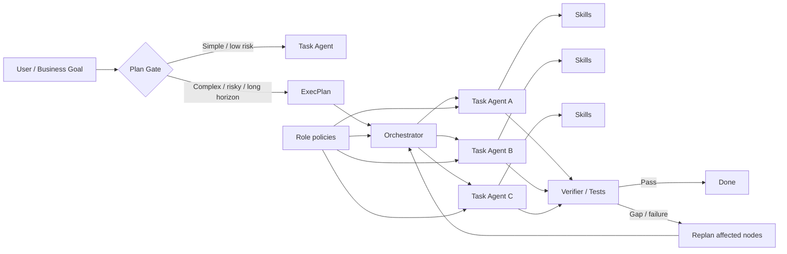
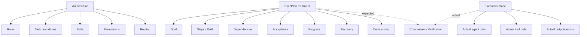
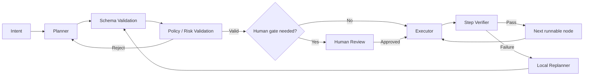
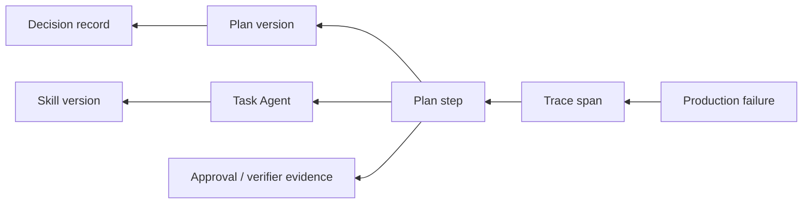

# ExecPlan có còn cần thiết khi đã có Role Agent, Task Agent và Skill Agent?

## Tóm tắt điều hành

**Kết luận chính: Có, nhưng không nên dùng ExecPlan mặc định cho mọi task.** Một kiến trúc agent tốt và một execution plan giải quyết **hai lớp vấn đề khác nhau**:

- **Agent architecture** trả lời: *ai làm, có năng lực gì, được phép làm gì, giao việc cho ai*.
- **ExecPlan** trả lời: *đối với lần chạy cụ thể này, cần đạt kết quả nào, đi qua những bước/dependency nào, kiểm chứng ra sao, xử lý sai lệch thế nào, và trạng thái hiện tại là gì*.

Vì vậy, Role/Task/Skill Agents **không triệt tiêu nhu cầu planning**; chúng chỉ làm giảm lượng planning phải viết ra ngoài. OpenAI hiện định nghĩa agent là đơn vị đóng gói model, instructions, tools, guardrails, handoffs và output contract; orchestration có thể dùng manager/agents-as-tools hoặc handoff. Trong khi đó, bài Codex ExecPlan định nghĩa ExecPlan như một **living, self-contained design document** để một agent không có ngữ cảnh trước đó vẫn có thể triển khai và kiểm chứng công việc end-to-end. Hai abstraction này gần như trực giao: một bên là **capability/ownership topology**, bên kia là **run-specific execution state and intent**. citeturn5view3turn5view4turn6view0

**Không có cơ sở tốt để áp một luật “mọi Task Agent đều phải có ExecPlan”.** Chính OpenAI hiện dùng cả *ephemeral lightweight plans* cho thay đổi nhỏ và execution plans được version-control cho công việc phức tạp; tài liệu best-practice chỉ khuyến nghị `PLANS.md` cho longer-running hoặc multi-step work. Nghiên cứu gần đây cũng cho thấy planning quá thường xuyên có thể tốn compute và thậm chí giảm hiệu năng; trong một nghiên cứu tool-calling năm 2026, full-horizon planning với replanning khi cần đạt accuracy tương đương step-by-step planning nhưng dùng ít token hơn khoảng 2–3 lần trên các benchmark được nghiên cứu. citeturn5view1turn0search17turn8view0turn8view3

Do đó, kiến trúc khuyến nghị là:

> **Architecture always; explicit ExecPlan selectively.**

Task Agent ngắn, deterministic, ít rủi ro và dễ rollback nên chạy trực tiếp hoặc với lightweight internal plan. Task dài, nhiều dependency, nhiều agent, có side effect quan trọng, cần audit/restart/human review nên tạo durable ExecPlan. Đối với hệ thống production, ExecPlan nên là **artifact điều phối có schema**, không phải một bài văn mà agent “hứa sẽ làm theo”.



Một chi tiết chưa được chỉ rõ trong yêu cầu là **URL của “linked ChatGPT Codex Exec Plans article” không xuất hiện trong nội dung tôi nhận được**. Báo cáo này giả định bạn đang nói tới bài chính thức của OpenAI Cookbook, **“Using PLANS.md for multi-hour problem solving”**, xuất bản ngày 7/10/2025. Trang này hiện được OpenAI đánh dấu là **archived**, nên tôi dùng nó làm nguồn gốc của khái niệm ExecPlan, đồng thời đối chiếu với tài liệu OpenAI mới hơn năm 2026 về harness engineering, Skills và Agents. citeturn5view0

## Role Agent, Task Agent và Skill Agent thực sự chịu trách nhiệm gì?

Điểm đầu tiên cần làm rõ là **Role Agent / Task Agent / Skill Agent không phải một taxonomy chuẩn chung của ngành**. OpenAI chính thức định nghĩa “agent” theo model + instructions + tools + guardrails + handoffs/output contract; MetaGPT dùng role specialization và SOP; còn chuẩn Agent Skills xem skill là một package tài nguyên để agent tải vào, **không phải một autonomous agent riêng biệt**. Vì vậy, phần dưới đây là một operational taxonomy phù hợp với kiến trúc mà câu hỏi mô tả, chứ không phải thuật ngữ chính thức của OpenAI. citeturn5view3turn2search2turn5view5turn1search3

| Thành phần | Câu hỏi chính | Trách nhiệm nên có | Không nên chịu trách nhiệm chính |
|---|---|---|---|
| **Role Agent** | “Ai chịu trách nhiệm?” | Domain ownership, policy, perspective, tool/permission boundary, quality standards | Chi tiết kế hoạch từng request |
| **Task Agent** | “Ai xử lý work item này?” | Hoàn thành bounded goal, quản lý local context, gọi tools/skills/subagents, trả artifact/result | Lưu toàn bộ organizational knowledge |
| **Skill / Skill Agent** | “Làm việc này bằng cách nào?” | Workflow tái sử dụng, instructions, scripts, references, templates | Ownership dài hạn hoặc quyết định mục tiêu |
| **ExecPlan** | “Run này sẽ đi từ A đến B thế nào?” | Decomposition, dependency, sequencing, acceptance, progress, decisions, recovery | Định nghĩa capabilities lâu dài của hệ thống |

### Role Agent

Role Agent nên đại diện cho **ổn định về trách nhiệm**, không phải một task cụ thể. Ví dụ `SolutionArchitect`, `SecurityReviewer`, `ERPFunctionalConsultant`, `QAAgent`. OpenAI khuyến nghị chỉ tách thêm agent khi cần khác biệt thật sự về ownership, instructions, tool surfaces hoặc approval policy; tách quá sớm làm tăng prompt, trace và approval surfaces mà chưa chắc làm workflow tốt hơn. MetaGPT cũng cho thấy role specialization kết hợp SOP là một cách tổ chức multi-agent cho các workflow phức tạp. citeturn5view3turn5view4turn2search2

Ví dụ:

```text
RoleAgent: ERPPostingArchitect

Owns:
  - accounting invariants
  - posting architecture
  - approval of cross-module design decisions

May use:
  - repository search
  - accounting-rule skill
  - schema-analysis skill

Cannot:
  - deploy production
  - alter tax rules without human approval
```

Điểm quan trọng là Role Agent nói **“tôi là ai và thẩm quyền của tôi đến đâu”**, không nhất thiết nói **“ticket ERP-428 hôm nay có bảy bước gì”**.

### Task Agent

Task Agent nên là **execution unit có lifecycle hữu hạn**, ví dụ:

```text
Task:
  Reconcile invoice posting between legacy and new engine
```

Nó có thể được gọi dưới dạng “agent as a tool”, subagent hoặc handoff target. OpenAI hiện phân biệt hai pattern chính: manager gọi specialist như bounded capability, hoặc handoff quyền sở hữu cho specialist. Đây chính là lớp thích hợp cho task-level execution. citeturn5view4turn1search8

Task Agent có thể tự lập kế hoạch cục bộ. Tuy nhiên, việc nó “biết cách suy nghĩ” **không tự động tạo ra durable execution contract** giữa các agent, giữa nhiều phiên chạy, hoặc giữa agent và con người. Đây là khoảng trống mà ExecPlan thường lấp vào.

### Skill Agent

Tên **“Skill Agent” dễ gây nhầm**. Trong OpenAI/Agent Skills hiện tại, một Skill là directory chứa `SKILL.md` cùng scripts/references/assets tùy chọn; hệ thống chỉ tải full skill khi phù hợp, tức progressive disclosure. Anthropic cũng định nghĩa Skills tương tự: reusable resources giúp general-purpose agent có domain workflows và expertise. citeturn5view5turn1search2turn1search3

Do đó, về mặt thiết kế tôi khuyến nghị:

> **Skill ≠ Agent**, trừ khi bạn cố tình wrap skill thành một agent riêng vì cần isolation, context riêng, model riêng hoặc permissions riêng.

Ví dụ:

```text
Role:       Security Reviewer
Task:       Review PR #481 for SQL injection
Skills:     [semgrep-triage, secure-sql-review, github-review]
ExecPlan:   optional, depending on scope/risk
```

Skill nói **how-to tái sử dụng**. Role nói **responsibility**. Task nói **instance of work**. ExecPlan nói **temporal execution contract**.

Đây cũng là lý do một kiến trúc có cả ba lớp Role/Task/Skill vẫn chưa đồng nghĩa với “đã có plan”.

## ExecPlan là gì, và nó khác một task decomposition thông thường ở đâu?

Bài Codex gốc gọi ExecPlan là một **design document mà coding agent có thể theo để tạo ra một working feature/system change**. Nó phải self-contained, living, outcome-focused, cập nhật khi có discoveries/decisions, và đủ để một agent stateless hoặc một novice tiếp tục công việc chỉ từ plan. citeturn6view0turn6view2

OpenAI yêu cầu bản mẫu có những phần như `Purpose / Big Picture`, `Progress`, `Surprises & Discoveries`, `Decision Log`, `Outcomes & Retrospective`, `Context and Orientation`, `Plan of Work`, `Concrete Steps`, `Validation and Acceptance`, `Idempotence and Recovery`, `Artifacts and Notes`, cùng `Interfaces and Dependencies`. Milestones phải independently verifiable; destructive/risky steps phải có recovery; acceptance phải mô tả observable behavior chứ không chỉ nói “code đã sửa”. citeturn6view1turn6view2

Điều này biến ExecPlan thành nhiều thứ cùng lúc:

**Specification + execution graph + checkpoint state + decision record + recovery guide + acceptance contract.**

Nó **không phải chain-of-thought** và không cần ghi lại reasoning nội bộ của model. Một plan production tốt chỉ cần externalizable facts: mục tiêu, assumptions, dependencies, steps, invariants, evidence, decisions và trạng thái.

### Các loại ExecPlan hữu ích

Không có taxonomy chính thức duy nhất. Tổng hợp OpenAI và nghiên cứu planning, có thể phân loại theo bốn chiều:

| Chiều | Các dạng | Phù hợp |
|---|---|---|
| **Độ bền** | Ephemeral → durable/versioned | Fix nhỏ → migration dài |
| **Planning horizon** | Single-step → full-horizon | Môi trường biến động → workflow xác định |
| **Topology** | Linear → DAG → hierarchical → search | Sequential → parallel dependencies → complex decomposition → exploration |
| **Khả năng thích nghi** | Static → living → replan-on-failure | Stable environment → uncertain environment |

OpenAI năm 2026 mô tả thực tế của họ là dùng **ephemeral lightweight plans** cho thay đổi nhỏ nhưng lưu execution plans của complex work trong repository cùng progress và decision logs. citeturn5view1

Nghiên cứu cũng phân biệt single-step horizon với full-horizon planning; một nghiên cứu khác phân loại execution modes thành predefined, sequential, hierarchical và search, đồng thời cho thấy generic Plan+ReAct thường không thực thi đúng planning structure đã tuyên bố trên các plan dài. Điều đó nhấn mạnh một điểm rất quan trọng: **có plan không đồng nghĩa với enforce được plan**. citeturn8view0turn8view1

### ExecPlan và SOP/Skill không giống nhau

Một Skill hoặc SOP thường là:

> “Khi migrate database, hãy backup → migrate → validate → rollback nếu fail.”

ExecPlan là:

> “Cho migration `customer_tax_profile` ngày hôm nay, schema version hiện tại là 41, target là 42, bảng X/Y phụ thuộc nhau, backup snapshot ID Z, step 3 do Task Agent A làm, validation query là Q, rollback trigger là R.”

Tức Skill/SOP là **procedure template**; ExecPlan là **instantiation của procedure vào một goal và state cụ thể**.

## Phần nào trùng nhau, và ExecPlan lấp khoảng trống nào?

Một kiến trúc Role/Task/Skill thiết kế rất tốt có thể hấp thụ khá nhiều chức năng của ExecPlan. Role chứa constraints, Skills chứa workflow chuẩn, Task Agent chứa local goal, orchestrator chứa routing. Vì vậy, nếu ExecPlan chỉ lặp lại những thứ này thì nó là bureaucracy bằng Markdown: trông nghiêm túc nhưng CPU và con người đều buồn. OpenAI cũng cảnh báo rằng tài liệu monolithic dễ stale, khó verify; họ chuyển sang repository knowledge có cấu trúc, còn `AGENTS.md` chỉ đóng vai trò bản đồ. citeturn5view1

Nhưng một số thông tin **không thuộc tự nhiên vào Role/Skill definitions**:

| Concern | Role/Task/Skill architecture | ExecPlan |
|---|---|---|
| Agent ownership | **Rất mạnh** | Có thể tham chiếu |
| Tool/permission boundaries | **Rất mạnh** | Ghi constraint của run |
| Reusable procedure | **Skill mạnh** | Instantiate procedure |
| Goal của request hiện tại | Task Agent có | **Explicit, durable** |
| Dependency giữa subtasks | Orchestrator có thể suy luận | **Explicit graph/order** |
| Acceptance criteria | Có thể nằm trong task | **First-class** |
| Progress qua nhiều giờ/session | Cần external state riêng | **First-class** |
| Tại sao đổi hướng | Thường không có | **Decision log** |
| Handoff cho agent mới | Có thể truyền context | **Restartability tốt** |
| Human pre-review | Khó nếu trajectory chưa tồn tại | **Rất mạnh** |
| Rollback/recovery | Skill có template | **Run-specific details** |
| Intention vs actual behavior | Trace chỉ cho actual | **Plan lưu intended** |

Đây là khác biệt bản chất giữa **trace và plan**. Tracing của OpenAI ghi model calls, tool calls, handoffs, guardrails và spans—nghĩa là *điều đã xảy ra*. ExecPlan mô tả *điều dự kiến xảy ra và vì sao*. Audit tốt thường cần cả hai để phát hiện “plan drift”. citeturn9search0turn9search2

Có thể biểu diễn như sau:



### Một insight quan trọng: architecture giảm *planning entropy*, không xóa planning

Giả sử task là “triển khai quy trình Sales Order mới”.

Một hệ thống chưa có Role/Skill architecture phải quyết định cùng lúc: ai phân tích nghiệp vụ, ai sửa backend, ai test, tool nào dùng, policy nào áp dụng, thứ tự công việc thế nào.

Nếu Role và Skills đã chuẩn hóa tốt, ExecPlan chỉ còn phải quyết định phần **delta của run hiện tại**:

```text
Goal-specific decomposition
+ current-state facts
+ dependencies
+ acceptance
+ exceptions
+ checkpoints
```

Đây chính là nơi architecture tốt giúp ExecPlan **ngắn hơn**, chứ không làm khái niệm plan biến mất.

## Khi ExecPlan tạo giá trị, và khi nó trở thành overhead

### Công việc phức tạp hoặc long-horizon

OpenAI thiết kế ExecPlan gốc cho complex features, significant refactors và multi-hour work; một phiên bản `PLANS.md` trong repository OpenAI Agents SDK còn quy định plan cho multi-step/multi-file work, features, refactors hoặc công việc ước tính trên khoảng một giờ. Đây nên được xem là heuristic của repository đó, không phải luật phổ quát. citeturn6view0turn7search11

Nghiên cứu Plan-and-Act cũng ủng hộ việc tách high-level planner khỏi environment-specific executor trong long-horizon tasks, bởi một model vừa phải giữ chiến lược tổng thể vừa xử lý low-level actions dễ mất consistency với objective. citeturn8view2

### Nhiều agent và dependency

Nếu hai Task Agents hoàn toàn độc lập, orchestrator có thể dispatch trực tiếp. Nhưng nếu:

```text
A → B
A → C
B + C → D
D → production approval
```

thì plan dạng DAG tạo ra contract rõ ràng cho scheduling, parallelism, context propagation và completion criteria. Một framework nghiên cứu năm 2026 dùng chính DAG decomposition + parallel execution + verification + adaptive replanning cho multi-agent orchestration và báo cáo cải thiện completeness/source quality trong tập market-research thử nghiệm của họ; kết quả đó chưa phải bằng chứng tổng quát cho mọi domain, nhưng cho thấy giá trị của orchestration-level planning tách khỏi individual agents. citeturn8view4

### Safety và blast radius lớn

Plan tạo điểm để review trước khi thực hiện irreversible/high-impact actions. Nhưng **plan approval không thể thay thế runtime authorization**. OpenAI tách rõ sandbox khỏi approvals: sandbox giới hạn resources có thể truy cập, còn approval quyết định lúc nào agent phải dừng để được phép vượt boundary. Human-in-the-loop còn có thể hoạt động xuyên handoff và nested-agent runs. citeturn4search1turn4search5turn1search32

Một pattern tốt:

```text
Approve plan ≠ approve every side effect.

Plan reviewed
    ↓
read-only actions: automatic
    ↓
workspace edits: policy-controlled
    ↓
production write / money / delete / publish:
    fresh approval required
```

### Auditability và compliance

ExecPlan hữu ích khi auditor cần biết không chỉ “agent đã làm gì” mà cả:

> “Mục tiêu ban đầu là gì, assumption nào được dùng, quyết định nào thay đổi, evidence nào chứng minh acceptance?”

OpenAI ExecPlan yêu cầu Progress, Decision Log, Surprises & Discoveries và Outcomes & Retrospective; tracing lại ghi operational trajectory. Hai artifact bổ sung lẫn nhau. citeturn6view2turn9search2

### Reproducibility và restartability

ExecPlan gốc đặt bar rất cao: một stateless agent hoặc novice phải có thể tiếp tục từ plan mà không cần context trước đó. Điều này đặc biệt hữu ích khi model/session bị compact, agent khác tiếp quản hoặc task kéo dài nhiều ngày. citeturn6view0turn6view3

Tuy nhiên, **plan không tự tạo reproducibility tuyệt đối**. Muốn tái lập đáng tin cậy nên lưu thêm commit SHA, input/data version, model/configuration, tool/skill version, environment assumptions và evidence artifacts. Trace/session state hiện đại cũng giúp lưu execution history và resumable state. citeturn9search14turn9search0

### Error recovery

Plan có giá trị lớn khi failure không nên dẫn tới “agent đoán lại mọi thứ từ đầu”. OpenAI yêu cầu ExecPlan mô tả idempotence, retry và rollback; ReAct và Reflexion cũng cho thấy feedback từ environment/failure có thể được dùng để điều chỉnh trajectory thay vì tiếp tục mù quáng. citeturn6view1turn2search0turn3search0

Pattern tốt là **local replan**, không regenerate toàn bộ plan:

```text
Step 8 fails
   ↓
Classify failure
   ↓
Does failure invalidate upstream assumptions?
   ├─ No → replan Step 8..10 only
   └─ Yes → invalidate affected dependency subtree
```

### Human oversight

Một plan reviewable giúp con người can thiệp ở tầng design thay vì xem từng tool call. Điều này phù hợp với xu hướng mà OpenAI mô tả cho long-horizon Codex: human steering ở milestones, agent đảm nhận implementation/verification, cùng guardrails để công việc reviewable và dễ ship. citeturn5view2

### Khi ExecPlan thừa

ExecPlan thường không đáng giá khi task:

```text
single agent
+ 1–3 predictable actions
+ no meaningful branching
+ no irreversible side effect
+ clear acceptance
+ execution < planning overhead
```

Ví dụ: đổi typo, format file, chạy một query read-only, summarize một document, thêm một unit test nhỏ.

Ở đây, Task Agent đã là đủ abstraction.

### Khi ExecPlan có thể gây hại

**Overplanning** làm tăng token, model calls và latency. Nghiên cứu “Learning When to Plan” cho thấy always-planning vừa tốn compute vừa có thể làm giảm performance trong long-horizon environments mà họ thử nghiệm; dynamic allocation tốt hơn hai cực “luôn plan” và “không bao giờ plan”. citeturn8view3

**Brittleness** xuất hiện khi plan giả định environment ổn định nhưng thực tế biến động. Một plan 30 bước viết trước cho GUI/web workflow có thể lỗi ngay bước 4; lúc đó việc bắt agent “follow plan exactly” trở thành anti-pattern. Plan-and-Act vì thế đưa environment feedback trở lại Planner để replan khi cần. citeturn8view2

**False confidence** xảy ra khi có plan đẹp nhưng executor không tuân thủ. Nghiên cứu tháng 9/2026 phát hiện generic Plan+ReAct chỉ giữ đúng declared planning structure trong khoảng 22–45% trajectories trên ba benchmark mà tác giả xem xét; pattern-specific executors cải thiện đáng kể execution fidelity. Vì vậy plan cần **runtime enforcement/verification**, không phải ritual Markdown. citeturn8view1

### So sánh tổng thể

| Phương án | Ưu điểm | Nhược điểm | Nên dùng |
|---|---|---|---|
| **Task Agent trực tiếp** | Latency thấp; ít token; adaptive | Ít audit/restart context | Task nhỏ, low-risk |
| **Task Agent + lightweight plan** | Ít overhead; có decomposition cơ bản | Không đủ durable/auditable | Medium task |
| **Durable ExecPlan** | Audit, handoff, recovery, acceptance, restart | Token/storage/maintenance overhead | Long-running/high-risk |
| **ExecPlan + planner/executor/verifier** | Tách strategy khỏi execution; enforceable hơn | Nhiều model calls, phức tạp | Critical workflows |
| **Static plan dài** | Dễ review upfront | Brittle trong môi trường động | Chỉ khi state ổn định |
| **Living/replanning plan** | Thích nghi tốt, giữ history | State management khó hơn | Long-horizon dynamic work |
| **Plan mọi task** | Consistency bề ngoài | Latency, cost, bureaucracy | **Không khuyến nghị** |
| **Không explicit plan bao giờ** | Đơn giản | Khó kiểm soát complex work | **Cũng không khuyến nghị** |

## Pattern tích hợp ExecPlan với kiến trúc agent

Pattern tôi khuyến nghị mạnh nhất là **Role = Policy, Skill = Procedure, Task = Worker, Plan = Run State**.

### Plan gate thay vì plan mặc định

Đừng để mọi Task Agent tạo ExecPlan. Cho orchestrator tính `planning_need`.

Ví dụ pseudocode:

```python
def choose_planning_mode(task):
    score = 0

    score += 2 if task.irreversible_side_effects else 0
    score += 2 if task.crosses_security_boundary else 0
    score += 2 if task.requires_human_review else 0

    score += 1 if task.expected_steps > 5 else 0
    score += 1 if task.agent_count > 1 else 0
    score += 1 if task.has_dependencies else 0
    score += 1 if task.expected_duration_minutes > 30 else 0
    score += 1 if task.must_resume_across_sessions else 0
    score += 1 if task.audit_required else 0

    if score <= 1:
        return "direct"
    if score <= 4:
        return "lightweight_plan"
    return "durable_exec_plan"
```

Các ngưỡng trên là **thiết kế đề xuất**, không phải tiêu chuẩn OpenAI. Nên tune bằng evals trên workload thật; OpenAI cũng khuyến nghị dùng traces/evals để benchmark thay đổi workflow thay vì dựa hoàn toàn vào trực giác kiến trúc. citeturn9search18turn4search33

### Planner → validator → executor

Đừng để planner vừa viết plan xong tự coi nó là chân lý.



Plan validation có thể gồm ba lớp:

1. **Structural:** JSON Schema, DAG acyclic, required fields, valid agent/skill IDs.
2. **Semantic:** dependencies đầy đủ, acceptance measurable, rollback tồn tại.
3. **Policy:** tool/agent/permission có phù hợp risk class hay không.

LLM có thể giúp semantic review, nhưng hard constraints như permission, tool allowlist, maximum budget hay DAG validity nên được enforce bằng deterministic code. Nghiên cứu về plan–execution gap cũng chỉ ra rằng executor chuyên biệt cho planning pattern có thể giữ cấu trúc đáng tin hơn việc chỉ prompt agent “hãy theo plan”. citeturn8view1

### Plan format

Markdown rất tốt cho humans và repo-based engineering; JSON/YAML tốt hơn cho orchestration machines.

Một compromise tốt:

```text
plan.yaml              ← machine contract
plan.md                ← human narrative / decisions
traces/                 ← actual execution
artifacts/              ← test evidence / reports
```

Hoặc một structured plan có human-readable fields:

```json
{
  "plan_id": "erp-tax-2026-042",
  "version": 3,
  "goal": "Migrate VAT posting rule without changing historical postings",
  "risk": "high",
  "status": "executing",
  "context": {
    "repo_commit": "abc123",
    "environment": "staging",
    "assumptions": [
      "Historical journal entries are immutable"
    ]
  },
  "steps": [
    {
      "id": "analyse",
      "role": "erp-functional-consultant",
      "task_agent": "posting-analysis-worker",
      "skills": ["vat-rule-analysis@2.1"],
      "depends_on": [],
      "acceptance": [
        "All affected posting scenarios are enumerated"
      ],
      "status": "done"
    },
    {
      "id": "implement",
      "role": "backend-engineer",
      "task_agent": "posting-code-worker",
      "skills": ["posting-engine-change@4.0"],
      "depends_on": ["analyse"],
      "acceptance": [
        "Legacy regression suite passes",
        "New VAT scenarios pass"
      ],
      "status": "running"
    },
    {
      "id": "deploy",
      "role": "release-manager",
      "depends_on": ["implement"],
      "approval": {
        "required": true,
        "type": "human"
      },
      "rollback": "restore release artifact v2026.10.25"
    }
  ]
}
```

Điểm thiết kế quan trọng là plan **tham chiếu Role/Skill bằng ID/version**, thay vì copy nguyên instructions vào plan.

Ở đây có một tension với ExecPlan Codex gốc: tài liệu 2025 yêu cầu self-contained rất mạnh, thậm chí khuyên embed kiến thức thay vì dựa vào external docs. Với một enterprise agent architecture hiện đại, copy toàn bộ role/skill knowledge vào mỗi plan dễ tạo duplication và stale state. OpenAI năm 2026 cũng nhấn mạnh repository knowledge có cấu trúc, tránh một monolithic manual, và Skills hiện được thiết kế cho reusable workflow/progressive disclosure. Vì vậy tôi khuyến nghị diễn giải lại **self-contained theo nghĩa operational**: plan phải chứa đủ facts riêng của run và pin rõ dependency versions; reusable procedure vẫn nằm trong Skills/source-of-truth. citeturn6view0turn5view1turn5view5

Nói cách khác:

```text
BAD:
ExecPlan copies 500 lines of "how to deploy"
every time.

BETTER:
skill = deployment-procedure@3.4
plan  = this deployment's inputs,
        dependencies, approvals,
        acceptance, rollback.
```

### Storage và versioning

Plan ngắn hạn có thể ở run state/database. Durable plan nên có version, owner, status, created-at, updated-at và relationship tới trace/build/commit. OpenAI thực tế lưu `exec-plans/active`, `exec-plans/completed` và technical-debt tracker trong repository của agent-first workflow, cho thấy plans có thể là first-class versioned artifacts. citeturn5view1

Khi nhiều agent cùng cập nhật, nên tránh để mỗi agent tự rewrite nguyên file. Một event model an toàn hơn:

```text
Plan v7
  |
  +-- step.started(A)
  +-- evidence.attached(A, test-983)
  +-- step.completed(A)
  +-- decision.recorded(...)
  +-- plan.revised(v8)
```

Rồi materialize current plan view từ event log. Điều này giảm lost update và giúp audit.

### Monitoring: đo plan drift, không chỉ success

Các metric đáng theo dõi:

```text
task_success_rate
plan_generation_latency
plan_validation_failure_rate
plan_revision_count
planned_vs_actual_steps
replan_rate
rollback_rate
human_intervention_rate
tokens_per_successful_task
wall_clock_time
parallelism_utilization
agent_handoff_count
```

Tracing hiện tại của OpenAI có thể ghi model/tool/handoff/guardrail spans và token usage, nên các metric kiểu trên có thể kết hợp plan IDs với trace IDs để phân tích. citeturn9search0turn9search2

Một metric đặc biệt hữu ích:

```text
Plan Fidelity =
completed planned steps
-----------------------
planned steps that remained valid
```

nhưng đừng tối ưu nó lên 100% một cách máy móc: trong môi trường động, **replan đúng lúc tốt hơn cố trung thành với plan sai**.

## Ví dụ thực tế và logic quyết định

### Ví dụ không cần ExecPlan

Yêu cầu:

> “Đổi label `Customer Ref.` thành `Customer Reference` trên form Sales Order.”

Architecture đã biết:

```text
UI Task Agent
  └── frontend-edit skill
      └── tests
```

Agent search field, sửa resource string, chạy tests.

Một full ExecPlan với Decision Log, Recovery, Outcomes... có khả năng tốn công hơn chính task. Lightweight internal checklist là đủ.

```text
1. Locate label source.
2. Change text.
3. Run affected UI test.
4. Return diff.
```

Đây là trường hợp explicit durable planning gần như không thêm thông tin quản trị nào đáng kể.

### Ví dụ nên có lightweight plan

Yêu cầu:

> “Thêm discount reason vào Sales Order, persist xuống DB và hiện trên invoice.”

Có UI → API → DB → reporting dependencies, nhưng phạm vi vẫn khá rõ.

```yaml
goal: support discount_reason end-to-end
steps:
  - id: schema
  - id: api
    depends_on: [schema]
  - id: ui
    depends_on: [api]
  - id: invoice
    depends_on: [api]
  - id: e2e
    depends_on: [ui, invoice]
```

Không nhất thiết cần một Codex-style plan dài vài trang. Một structured 15–30 dòng có thể đã đủ.

### Ví dụ rất nên có durable ExecPlan

Yêu cầu:

> “Chuyển logic tính và hạch toán VAT của ERP từ legacy posting engine sang service mới, vẫn bảo toàn historical postings, migration dữ liệu có rollback, QA đối chiếu song song trước go-live.”

Đây là task có:

```text
multiple domains
+ multiple roles
+ multiple agents
+ irreversible migration risk
+ sequential + parallel dependencies
+ business invariants
+ audit requirements
+ long execution horizon
+ human approval
```

Role architecture có thể là:

```text
Functional Consultant
Solution Architect
Migration Engineer
Backend Engineer
QA/Reconciliation Agent
Security Reviewer
Release Manager
```

Skills có thể là:

```text
vat-rule-analysis
schema-diff
migration-generator
posting-regression
financial-reconciliation
release-rollback
```

Nhưng chúng vẫn chưa trả lời:

```text
Which VAT scenarios are in this release?
Which schema version is source/target?
What is the migration order?
What evidence proves no historical change?
When can parallel execution begin?
Which discrepancy blocks release?
Who approves go-live?
Which snapshot enables rollback?
```

Đó chính là ExecPlan.

Một plan rút gọn:

```json
{
  "goal": "Move VAT posting to the new engine with accounting parity",
  "invariants": [
    "No historical journal entry may change",
    "Debit must equal credit for every migrated scenario",
    "Legacy/new-engine variance must be zero for critical scenarios"
  ],
  "phases": [
    "baseline",
    "design",
    "implementation",
    "shadow-run",
    "reconciliation",
    "approval",
    "cutover"
  ],
  "gates": {
    "shadow_to_release": {
      "variance": 0,
      "critical_tests_passed": true,
      "human_approval": true
    }
  },
  "rollback": {
    "trigger": "post-cutover accounting mismatch",
    "strategy": "restore previous routing and database snapshot"
  }
}
```

Ở đây ExecPlan không cạnh tranh với agents. Nó **chỉ huy agents**.

## Tiêu chí quyết định và trade-off triển khai

Cách tốt nhất là đánh giá **need for externalized planning**, không hỏi đơn giản “task agent có biết plan không?”.

### Checklist quyết định ngắn

| Câu hỏi | Nếu “Có” |
|---|---|
| Task có > một agent/domain không? | + plan |
| Có dependency hoặc parallel branches không? | + plan |
| Task kéo dài qua session/context boundary không? | + durable plan |
| Có hành động khó rollback/irreversible không? | + plan + approval |
| Cần human review trước execution không? | + plan |
| Cần audit/compliance/decision history không? | + durable plan |
| Acceptance có nhiều invariants hoặc stages không? | + plan |
| Environment thay đổi nhiều sau mỗi action không? | Tránh rigid full plan; dùng adaptive plan |
| Task chỉ vài predictable actions, low-risk? | Không cần durable plan |
| Chi phí lập plan gần bằng/greater than execution? | Skip hoặc lightweight plan |

Một rule thực tế:

> **0–1 tín hiệu:** direct execution.  
> **2–3 tín hiệu:** lightweight structured plan.  
> **4+ tín hiệu hoặc high-risk flag:** durable ExecPlan + validation + checkpoints.

Các con số này là heuristic thiết kế, không phải threshold được OpenAI chuẩn hóa.

### Performance

Chi phí ExecPlan bao gồm ít nhất một planner invocation, thêm context tokens, validation và synchronization. Nếu step-by-step planner gọi model trước mọi action thì overhead còn lớn hơn. Kết quả 2026 trên data-centric tool calling cho thấy full-horizon + lazy replanning có thể đạt accuracy tương đương với 2–3× ít token hơn single-step trong các benchmark đó; nghiên cứu dynamic planning cũng cho thấy “luôn plan” không tối ưu. Do đó, **planning frequency nên adaptive**. citeturn8view0turn8view3

Ngược lại, plan có thể giảm wall-clock time nếu nó cho phép tìm dependencies sớm và chạy các nodes độc lập song song. Vì vậy cần đo **total time-to-success**, không chỉ planning latency.

### Brittleness

Một plan càng low-level, càng nhanh stale.

Không nên viết:

```text
Step 27: click the third button from the left.
```

nếu hệ thống hỗ trợ:

```text
Step: approve_invoice
Precondition: invoice.status == READY_FOR_APPROVAL
Postcondition: invoice.status == APPROVED
```

Plan nên mô tả **intent + contract**, executor/Skill chịu trách nhiệm mechanics. Điều này vừa giảm brittleness vừa làm Role/Task/Skill architecture thật sự có ích.

### Security

Một explicit plan **không tự làm hệ thống an toàn hơn**. Plan thậm chí có thể trở thành kênh lan truyền prompt injection nếu agent lấy nội dung từ web/email/document rồi chèn trực tiếp thành “instructions”. OpenAI cảnh báo prompt injection có thể dẫn tới data exfiltration hoặc unintended downstream tool calls; Skills cũng có rủi ro injection-driven exfiltration, đặc biệt khi kết hợp network access. citeturn4search0turn4search31

Thiết kế production nên coi:

```text
User intent      = trusted only within authorization
Plan             = untrusted structured proposal
External content = data, never authority
Executor          = constrained by policy
Tools             = least privilege
High-impact call  = approval gate
```

Nên pin Skill version, validate plan schema, reject unknown agents/tools, giới hạn filesystem/network bằng sandbox, tách credentials khỏi planner context, và không cho plan tự mở rộng quyền. OpenAI khuyến nghị chọn permission scope hẹp nhất đủ để task tiếp tục. citeturn4search1turn4search21

### Auditability và observability

Nên gắn:

```text
plan_id
plan_version
step_id
role_id
task_agent_id
skill_versions
trace_id
artifact_ids
approval_ids
```

vào từng execution span.

Khi đó một lỗi production có thể được truy ngược:



Tracing của Agents SDK hiện hỗ trợ model calls, tools, handoffs, guardrails và custom spans, nên đây là một mapping khả thi về mặt kiến trúc. citeturn9search2

### Recommendation cuối cùng

Tôi sẽ không thiết kế hệ thống theo:

```text
Every Task Agent MUST create an ExecPlan.
```

Tôi cũng sẽ không thiết kế:

```text
Our agents are well-designed,
therefore explicit plans are unnecessary.
```

Kiến trúc hợp lý hơn là:

```text
Role Agent
    = stable responsibility + policy

Skill
    = reusable know-how + scripts

Task Agent
    = bounded execution worker

ExecPlan
    = optional, run-specific coordination artifact

Trace
    = actual execution record
```

Sau đó đặt một **Plan Gate** ở orchestration layer để chọn giữa:

```text
Direct
→ Lightweight Plan
→ Durable ExecPlan
→ Durable ExecPlan + Planner/Executor/Verifier + Human Gates
```

Điều này cũng phù hợp nhất với hướng phát triển hiện tại của OpenAI: agent systems nên bắt đầu đơn giản và chỉ thêm specialists/orchestration khi contract thực sự thay đổi; Skills là reusable workflows; small changes có thể dùng lightweight ephemeral plans; complex/long-running work được hưởng lợi từ durable execution plans, validation, previews, guardrails và rollback. citeturn5view4turn5view5turn5view1turn5view2

**Tóm lại:** trong một kiến trúc Role–Task–Skill tốt, ExecPlan không còn là “bộ não hướng dẫn agent phải biết làm việc thế nào”. Vai trò tốt hơn của nó là **transaction-level control plane cho công việc phức tạp**: đóng băng intent đủ lâu để review, chia nhỏ dependency, điều phối agents, ghi progress/decision, kiểm chứng outcome và recover khi execution lệch khỏi kỳ vọng. Với task đơn giản, bỏ nó đi. Với task phức tạp hoặc high-risk, bỏ nó đi thường là đang tiết kiệm Markdown để mua thêm sự hỗn loạn.

## Nguồn cốt lõi và mức độ tin cậy

Nguồn trung tâm là OpenAI Cookbook **“Using PLANS.md for multi-hour problem solving”**; đây là nguồn gốc trực tiếp của ExecPlan nhưng hiện được đánh dấu archived, nên các chi tiết format trong đó nên hiểu là một implementation pattern chứ không phải universal protocol. citeturn5view0turn6view2

Để đánh giá cách pattern này phù hợp với kiến trúc agent hiện nay, báo cáo ưu tiên tài liệu OpenAI hiện hành về **Agent definitions, orchestration/handoffs, Skills, security, tracing và harness engineering**. Các nguồn này cho thấy agent specialization, Skills, plan artifacts và observability đang tồn tại như các abstraction riêng biệt thay vì một abstraction thay thế tất cả. citeturn5view3turn5view4turn5view5turn4search1turn9search2turn5view1

Về bằng chứng nghiên cứu, các kết luận về explicit planning dựa trên các công trình gốc như **ReAct**, **Plan-and-Solve**, **MetaGPT**, **Plan-and-Act**, cùng các nghiên cứu 2026 về planning horizon, dynamic planning và plan–execution gap. Chúng không chứng minh rằng một dạng ExecPlan cụ thể tối ưu cho mọi workload; chúng nhất quán hơn ở kết luận rằng planning hữu ích khi complexity/horizon tăng nhưng **planning strategy và planning frequency phải phù hợp task**, và execution/verification quan trọng không kém việc tạo ra một plan nghe có vẻ hợp lý. citeturn2search0turn2search1turn2search2turn8view2turn8view0turn8view3turn8view1