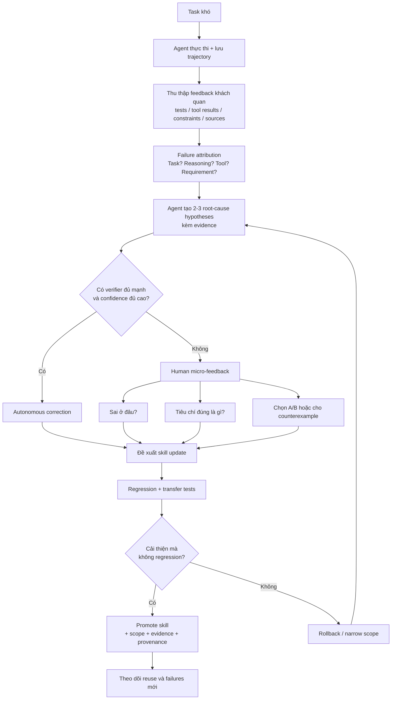
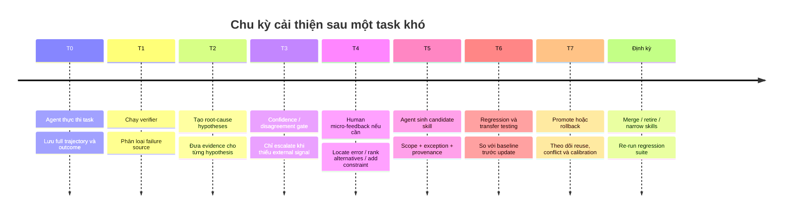

# Vì sao agent “tự rút kinh nghiệm” thường cải thiện kém khi làm một mình — nhưng tiến bộ rõ khi có người cùng vòng lặp

## Tóm tắt điều hành

Quan sát của bạn có cơ sở khá vững, nhưng cần diễn đạt chính xác hơn:

> **Vấn đề không phải là agent nhất thiết cần con người; vấn đề là agent cần một tín hiệu học tập đủ độc lập, đủ giàu thông tin và đủ gắn với mục tiêu thực.** Khi không có verifier, environment feedback hay oracle đáng tin, con người thường là nguồn tín hiệu tốt nhất.

Các nghiên cứu về self-correction cho thấy hai mặt tưởng như mâu thuẫn. Một phía, **Self-Refine** cho thấy một LLM có thể tự sinh feedback và tự chỉnh đầu ra, đạt mức cải thiện trung bình khoảng 20 điểm phần trăm trên bảy tác vụ; **Reflexion** cũng cho thấy phản tư bằng ngôn ngữ và episodic memory có thể tạo cải thiện lớn. citeturn14search1turn14search0 Nhưng phía còn lại, nghiên cứu ICLR *Large Language Models Cannot Self-Correct Reasoning Yet* cho thấy self-correction thuần nội tại thường không sửa được suy luận và đôi khi còn làm kết quả tệ hơn; RISE cũng bắt đầu từ quan sát rằng ngay cả những LLM mạnh cũng không mặc nhiên cải thiện liên tục chỉ vì được thêm lượt suy nghĩ. citeturn13search5turn14search3

Điểm nối hai nhóm kết quả là **chất lượng feedback**. Trong coding, Olausson và cộng sự phát hiện self-repair bị bottleneck ở chính khả năng model đánh giá code của mình: thay critic bằng model mạnh hơn giúp đáng kể, còn feedback debugging của con người cho GPT-4 tạo khoảng cách lớn hơn nữa so với self-repair thuần túy. citeturn15search8turn15search20 Trong robotics, Res-HIL năm 2026 cho thấy mỗi can thiệp của người vừa cung cấp **supervision trực tiếp**, vừa cung cấp **reward shaping**; phương pháp này vượt autonomous residual fine-tuning trên cả năm tác vụ thao tác được thử nghiệm. citeturn17search6

Vì vậy, hiện tượng bạn thấy rất có thể đến từ một chuỗi nguyên nhân:

**agent làm task khó → cùng một mô hình lại tự đánh giá task đó → lỗi của “người làm” và “người chấm” tương quan với nhau → lesson được rút ra thiếu hoặc sai → lesson sai được tổng quát hóa thành skill → lần sau không cải thiện, thậm chí regression.**

Khi bạn tham gia, bạn thêm vào hệ thống những thông tin mà trace tự thân không chứa rõ: *ý định thật*, *tiêu chí nào quan trọng*, *lỗi nằm ở đâu*, *ngoại lệ nào cần giữ*, *trade-off nào chấp nhận được*. RLHF là một ví dụ quy mô lớn về nguyên lý này: InstructGPT dùng demonstrations và rankings từ con người để học gần hơn với user intent; trong đánh giá của nghiên cứu, model InstructGPT 1.3B được người chấm ưa thích hơn GPT-3 175B mặc dù nhỏ hơn hơn 100 lần. citeturn18search2turn18search14

Tuy nhiên, **“thêm human” không tự động tạo synergy**. Meta-analysis trên 106 thí nghiệm và 370 effect sizes cho thấy tổ hợp human–AI trung bình tốt hơn human đơn độc, nhưng trung bình lại không vượt “thành viên tốt nhất” trong cặp human/AI; synergy phụ thuộc mạnh vào task và cách phân vai. citeturn13search2 Do đó thiết kế tốt không phải *human-in-every-loop*, mà là **human-on-the-information-bottleneck**: agent tự làm phần có verifier tốt; chỉ gọi người khi uncertainty cao, objective mơ hồ, feedback xung đột hoặc hậu quả của một lesson sai lớn.

Nói kiểu BA: **log lỗi cho biết “system failed”; SME cho biết “nó vi phạm business intent nào”.** Self-improvement cần cái thứ hai nhiều hơn ta tưởng.

## Khung lý thuyết: self-improvement thực chất là bài toán chất lượng feedback

Có thể mô hình hóa một vòng tự cải thiện đơn giản như sau. Agent có policy hiện tại \(\pi_t\), nhận task \(x\), tạo trajectory \(\tau_t\) và output \(y_t\). Một evaluator \(E\) sinh feedback \(f_t\), sau đó update operator \(U\) biến trải nghiệm đó thành memory, rule, prompt, skill hoặc cập nhật tham số:

\[
y_t,\tau_t \sim \pi_t(x)
\]

\[
f_t = E(x,\tau_t,y_t)
\]

\[
\pi_{t+1}=U(\pi_t,\tau_t,f_t)
\]

Điểm quyết định không nằm ở chữ “reflection”, mà nằm ở **\(E\) biết thêm gì mà \(\pi_t\) chưa biết**.

Nếu generator và evaluator thực chất là cùng một model, cùng context, cùng kiến thức và cùng blind spots, ta có nguy cơ **correlated error**: model sai vì hiểu thiếu constraint A, rồi critic của chính nó cũng không biết A nên kết luận rằng vấn đề nằm ở B. Kết quả là vòng lặp rất hoạt động, rất nhiều token, nhưng thông tin mới gần bằng không. Kết quả thực nghiệm về intrinsic self-correction và self-repair coding phù hợp với cơ chế này. citeturn13search5turn15search8

### Các framework nhìn cùng một vấn đề từ những góc khác nhau

| Framework | “Cái gì đang được học?” | Feedback quan trọng đến từ đâu? | Dự đoán cho trường hợp của bạn |
|---|---|---|---|
| **Self-improvement / self-reflection** | Cách giải task, memory hoặc rule sau mỗi attempt | Tự critique, verifier hoặc environment | Có thể hiệu quả nếu feedback đủ grounded; self-critique thuần nội tại dễ mắc cùng blind spot với lần giải đầu. Reflexion và Self-Refine chứng minh tiềm năng; Huang et al. chỉ ra giới hạn. citeturn14search0turn14search1turn13search5 |
| **Human-in-the-loop** | Policy/hành vi được sửa ngay quanh failure state | Human correction, intervention, preference | Một intervention đúng chỗ có thể có information density cao hơn hàng loạt autonomous retries; robotics cho bằng chứng khá mạnh. citeturn17search3turn17search6 |
| **Active learning** | Chỉ xin nhãn/feedback cho những case “đáng hỏi” | Oracle/human trên các mẫu được chọn | Không cần bạn review mọi task: agent nên hỏi ở các case uncertainty, novelty hoặc disagreement cao. Active learning vốn được thiết kế để đạt performance với ít annotation hơn bằng selective querying. citeturn13search0turn13search32 |
| **Meta-learning** | Khả năng *học nhanh cách giải task mới* | Phân bố nhiều tasks trong meta-training | Không chỉ lưu lesson; phải học một update rule đủ tốt để từ ít trải nghiệm có thể thích nghi. MAML là ví dụ kinh điển về tối ưu model để thích nghi nhanh bằng ít data mới. citeturn18search0 |
| **RLHF / preference learning** | Reward proxy đại diện cho “điều con người thực sự muốn” | Rankings, demonstrations, preference comparisons | Khi objective khó viết thành metric, human feedback giúp giải bài toán “đúng theo ý người” thay vì chỉ “đúng theo proxy”. citeturn18search1turn18search2 |
| **Collaborative problem solving** | Shared problem model và phân bổ chuyên môn | Trao đổi hiểu biết, effort, knowledge và skills | Human và agent có lợi khi mỗi bên bổ sung thứ bên kia thiếu, chứ không phải cùng làm trùng một việc. OECD định nghĩa CPS quanh việc chia sẻ hiểu biết, effort và pooling knowledge/skills. citeturn18search3 |

**Meta-learning** đặc biệt hữu ích để phân biệt “ghi nhớ bài học” với “học cách học”. Một agent có thể tích lũy 500 dòng `lessons.md` mà vẫn không meta-learn gì cả. MAML đặt mục tiêu rõ hơn: tối ưu trạng thái ban đầu sao cho một lượng nhỏ dữ liệu mới đủ để adaptation tốt. citeturn18search0 Với LLM agent, một analogue thực dụng là không chỉ lưu “lần trước phải làm X”, mà học template chung như: *khi loại failure F xuất hiện → thu thập evidence E → phân biệt hypotheses H1/H2 → chỉ sửa component C → regression-test R*.

**RLHF** cũng giải thích tại sao sự cộng tác của bạn có thể tạo khác biệt rất lớn dù feedback rất ngắn. Christiano và cộng sự cho thấy có thể học complex goals từ lựa chọn giữa các cặp trajectory thay vì yêu cầu con người viết một reward function hoàn chỉnh. citeturn18search1 Nghĩa là bạn không nhất thiết phải “dạy lại bài”; đôi khi chỉ cần nói **A tốt hơn B vì constraint X** đã cung cấp được tín hiệu mà agent tự generate không có.

**Active learning** chỉ ra bước tiếp theo: agent không nên tiêu human budget đồng đều. Nó nên chủ động tìm những tình huống có expected information gain cao nhất để hỏi. Các tổng quan active learning hiện đại vẫn định nghĩa cốt lõi của phương pháp là chọn những instance có giá trị thông tin cao để giảm số nhãn cần lấy từ human oracle. citeturn13search0turn13search32

**Collaborative problem solving** bổ sung một góc quan trọng: collaboration không chỉ là “human đánh giá output”. Theo OECD, giải quyết vấn đề cộng tác đòi hỏi tạo shared understanding và kết hợp kiến thức, kỹ năng, công sức của các bên. citeturn18search3 Trong agent design, điều này gợi ý rằng human nên giữ những phần model yếu nhất—business intent, tacit constraints, exception policy, risk tolerance—còn agent giữ search, synthesis, execution, regression và bookkeeping.

## Bằng chứng thực nghiệm: điều gì xảy ra trong coding, writing, robotics và tutoring

Bằng chứng hiện tại **không tạo thành một RCT duy nhất bao phủ cả bốn domain**. Một số nghiên cứu so trực tiếp autonomous improvement với human feedback; một số khác so human–AI với human-only hoặc AI-only. Vì vậy, nên xem chúng như một chuỗi bằng chứng hội tụ thay vì tuyên bố “human luôn thắng autonomous agent”.

| Domain / nghiên cứu | Chế độ | Kết quả chính | Điều nó nói với bài toán self-improvement |
|---|---|---|---|
| **Coding — Olausson et al., ICLR 2024** | Model tự debug code của chính mình; sau đó thay feedback bằng stronger model/human | Khi tính cost repair, gain từ self-repair thường nhỏ, phụ thuộc subset và đôi khi biến mất; stronger feedback cho gain lớn hơn, human debugging cho thấy khoảng cách đáng kể so với self-repair. citeturn15search0turn15search8 | **Feedback quality là bottleneck**, không phải số vòng reflection. |
| **Coding — Reflexion** | Autonomous reflection nhưng dùng task feedback / episodic memory | Báo cáo 91% pass@1 trên HumanEval; framework có thể dùng feedback bên ngoài hoặc self-simulated. citeturn14search0 | Autonomous improvement hiệu quả hơn khi có **grounded outcome signal**; không nên đồng nhất Reflexion với “agent hoàn toàn tự biết đúng-sai”. |
| **Coding — GitHub Copilot experiment** | Human + AI pair programming | Nhóm có Copilot hoàn thành HTTP-server task nhanh hơn 55.8% so với control. citeturn15search5turn15search25 | Human giữ mục tiêu/verification trong khi AI tăng tốc generation là một phân vai có giá trị, dù đây không phải thí nghiệm self-improvement. |
| **Writing — Self-Refine** | Same LLM = generator + critic + refiner | Khoảng 20 điểm % cải thiện trung bình trên 7 tasks theo metrics/human preferences. citeturn14search1turn14search13 | Self-feedback **có thể** đủ trên task mà model đã có khả năng nhận diện chất lượng tương đối tốt. |
| **Writing — Noy & Zhang, Science** | Professional + ChatGPT | Trong thí nghiệm với 453 professionals, thời gian trung bình giảm 40%, chất lượng tăng 18%. citeturn15search2turn15search6 | Human–AI cooperation đặc biệt mạnh khi người dùng có thể chọn, sửa và contextualize nội dung. |
| **Writing — FeedbackWriter, CHI 2026** | AI đề xuất feedback, TA review/adopt/edit | RCT với 354 sinh viên và 11 TAs cho thấy AI-mediated human feedback tạo revision tốt hơn human-only. citeturn15search3turn15search19 | Một kiến trúc tốt không cần chọn “AI hay human”; AI có thể chuẩn bị candidate feedback, human kiểm duyệt điểm có leverage cao. |
| **Robotics — DQN-TAMER** | Environment reward + human feedback | Outperform baselines ở Maze và Taxi; khi human feedback dừng, agent vẫn tiếp tục học từ environment rewards. citeturn17search1turn17search35 | Human feedback tốt nhất khi **bổ sung**, không thay toàn bộ autonomous signal. |
| **Robotics — Correct Me if I am Wrong** | Interactive human correction | Feedback được lấy trên chính distribution mà policy đang tạo, giúp tránh mismatch của dataset demonstration cố định và hỗ trợ self-correcting behavior. citeturn17search3turn17search7 | Hỏi human **sau failure thực tế** thường giá trị hơn thêm nhiều generic examples trước deployment. |
| **Robotics — Res-HIL, 2026** | Human interventions + residual RL | Với 20 demonstrations ban đầu, vượt autonomous residual fine-tuning trên 5 manipulation tasks sau online adaptation; ablation cho thấy direct residual supervision đặc biệt quan trọng, reward shaping cải thiện efficiency. citeturn17search6 | Đây là một trong những bằng chứng trực tiếp mạnh nhất cho giá trị của **corrective intervention tại failure state**. |
| **Tutoring — Tutor CoPilot** | Human tutor + AI expert support | RCT với khoảng 900 tutors và 1,800 học sinh; topic mastery tăng khoảng 4 điểm %, và khoảng 9 điểm % với tutors ban đầu được đánh giá thấp hơn. citeturn16search0turn16search8 | AI hiệu quả khi nâng chất lượng quyết định của human tại đúng thời điểm thay vì cố thay thế teacher loop. |
| **Tutoring — Bastani et al., PNAS 2025** | Học sinh dùng GPT-4 không guardrails vs guarded tutor | Unguarded access khiến học sinh dễ dựa AI như “crutch” và sau đó kém hơn khi phải tự làm; safeguards giảm tác động tiêu cực. citeturn16search5turn16search13 | “AI làm nhiều hơn” không đồng nghĩa “system học tốt hơn”; cấu trúc feedback và scaffolding quan trọng. |
| **Tutoring — Hybrid human–AI, 2026** | Human–AI tutoring so với giai đoạn AI-only | Nghiên cứu quasi-experimental trên 635 học sinh báo cáo tăng time-on-task, skill proficiency và academic growth so với AI-only baseline. citeturn16search2turn16search6 | Human input có giá trị lớn nhất với những learner/state khó, gợi ý **conditional escalation** thay vì review tất cả. |

Hai counterexample đặc biệt quan trọng tránh kết luận quá mạnh rằng “không có human thì không thể tự cải thiện”.

Thứ nhất, **Voyager** học trong Minecraft mà không có human intervention, dùng automatic curriculum, executable skill library, environment feedback, execution errors và self-verification. Nó thu thập nhiều item hơn, đi xa hơn và đạt các technology milestones nhanh hơn các baseline của nghiên cứu. citeturn14search2turn14search26 Điểm đáng chú ý là Voyager **không hề bị cô lập về epistemic feedback**: Minecraft cho nó một thế giới khách quan để kiểm tra chương trình “chạy hay không chạy”, item “lấy được hay chưa”, action “thành công hay chưa”.

Thứ hai, **Self-Refine** chứng minh rằng same-model feedback không phải lúc nào cũng vô dụng. citeturn14search1 Điều này hợp lý ở các task mà model đã có latent ability để phân biệt output A tốt hơn B nhưng lần generation đầu chưa tìm được A. Ngược lại, khi failure đến từ **thiếu kiến thức, hiểu sai objective hoặc không biết mình sai**, thêm một lượt của cùng knowledge state khó tạo thông tin mới. Đây là cách hòa giải Self-Refine với kết quả tiêu cực về intrinsic self-correction của Huang et al. citeturn13search5

Nói cách khác:

\[
\text{autonomous improvement tốt}
\not\Rightarrow
\text{agent tự làm mọi thứ}
\]

mà thường là:

\[
\text{autonomous improvement tốt}
\approx
\text{agent} + \text{independent feedback channel}
\]

Human chỉ là một independent feedback channel đặc biệt linh hoạt.

Meta-analysis *When combinations of humans and AI are useful* càng nhấn mạnh rằng việc ghép người và AI không mặc nhiên tạo “siêu đội”. Nghiên cứu tổng hợp 370 effect sizes từ 106 experiments cho thấy human–AI có lợi so với human-only trung bình, nhưng không vượt thành viên tốt nhất trung bình; synergy tốt hơn ở content creation so với nhiều decision tasks. citeturn13search2 Vì vậy, **vai trò và routing** quan trọng hơn khẩu hiệu “human-in-the-loop”.

Trong bối cảnh Việt Nam, các tài liệu giáo dục gần đây cũng đi theo hướng human-centered: Bộ GD&ĐT nhấn mạnh năng lực AI của giáo viên và tích hợp AI vào dạy học, trong khi các bài viết của Tạp chí Giáo dục cảnh báo việc phụ thuộc vào AI có thể làm giảm động lực đào sâu, kiểm chứng và tư duy phản biện nếu người học tiếp nhận kết quả thụ động. citeturn20search0turn20search4 Tuy vậy, nguồn Việt Nam hiện chủ yếu hữu ích cho khía cạnh giáo dục/ứng dụng; bằng chứng causal trực tiếp về **agent self-improvement sau failure** vẫn chủ yếu đến từ nghiên cứu quốc tế.

## Vì sao self-improvement tự trị dễ hỏng sau chính những task khó nhất

Nghịch lý quan trọng là: **task càng cần self-improvement thì thường càng là task mà self-evaluation kém đáng tin nhất**.

### Misaligned objective: agent học từ proxy chứ không học từ intent

Ở một task đơn giản, “đúng” có thể là unit test pass. Ở task ERP, writing, architecture hay analysis, “đúng” thường chứa nhiều tiêu chí latent: đúng nghiệp vụ, maintainable, phù hợp politics của tổ chức, không phá process downstream, đủ auditability, đúng mức detail.

Nếu agent chỉ nhìn output và lỗi cuối cùng, nó có thể optimize một proxy:

> “User sửa phần này → từ nay luôn làm X.”

Trong khi causal lesson thực sự có thể là:

> “Chỉ làm X khi process thuộc loại Y và constraint Z tồn tại.”

Đây chính là vấn đề alignment: model lớn hơn không tự động đồng nghĩa với hiểu user intent tốt hơn; InstructGPT cho thấy human demonstrations và preference rankings có thể thay đổi đáng kể mức độ phù hợp với ý định người dùng. citeturn18search2

**Triệu chứng:** lesson có vẻ hợp lý nhưng quá tổng quát; agent cải thiện case vừa thất bại nhưng regression ở case khác.

**Thuốc:** lưu cả **rule + scope + exception + evidence**, không chỉ một “lesson learned”.

### Sparse hoặc noisy feedback: “failed” có entropy cao nhưng information gain thấp

Một task có thể fail do planning, retrieval, tool call, reasoning, implementation, requirement ambiguity hoặc evaluation. Một bit `FAIL` nói rằng có gì đó sai nhưng gần như không nói **sai ở đâu**.

Robotics làm vấn đề này rất rõ: delayed environment rewards khiến credit assignment khó; DQN-TAMER bổ sung human feedback gần thời điểm hành động để giảm khoảng cách giữa hành vi và tín hiệu học. citeturn17search1 Res-HIL tiến thêm một bước: intervention đồng thời trở thành direct supervision cho corrective action và reward shaping cho hành vi trước intervention. citeturn17search6

Với LLM agent, câu của bạn như:

> “Không, vấn đề không phải format. Em đã giả định warehouse A và B dùng cùng rule replenishment.”

có thể đáng giá hơn năm vòng `"reflect deeply on your mistakes"` vì nó giải quyết **credit assignment**.

### Catastrophic forgetting và interference: học cái mới bằng cách phá cái cũ

Trong continual learning với **parameter updates**, catastrophic forgetting là hiện tượng thật và kinh điển: học task mới có thể phá kiến thức cần cho task cũ; Elastic Weight Consolidation được đề xuất để bảo vệ những weights quan trọng cho kiến thức trước đó. citeturn19search0

Nhưng cần phân biệt: nếu “self-improvement” của bạn chỉ chỉnh **prompt, memory hoặc skill files**, đó không phải catastrophic forgetting theo nghĩa neural weights. Vấn đề tương đương thực tế thường là **memory interference**:

- rule mới conflict rule cũ;
- retrieval lấy nhầm lesson;
- prompt dài làm giảm salience;
- edge-case lesson bị biến thành universal rule;
- cùng một failure được lưu dưới nhiều cách diễn đạt và bắt đầu “bỏ phiếu” cho chính nó.

Voyager tránh phần nào vấn đề bằng một skill library dạng executable, compositional và reusable thay vì liên tục fine-tune toàn bộ model. citeturn14search2

### Exploration–exploitation: tự sửa dễ mắc kẹt ở cùng một local optimum

Sau failure, agent thường có xu hướng **exploit cùng cách hiểu**, chỉ thay chi tiết:

`plan A → A' → A'' → A'''`

thay vì đặt câu hỏi:

`Có phải toàn bộ decomposition A sai?`

Meta-learning và active learning đều gợi ý rằng adaptation tốt cần lựa chọn trải nghiệm có giá trị, không chỉ tăng số lần chạy. citeturn18search0turn13search0 Voyager giải quyết vấn đề exploration bằng một automatic curriculum chọn mục tiêu mới dựa trên trạng thái hiện tại thay vì chỉ lặp lại một failure. citeturn14search2

Human thường giúp bằng một câu cực rẻ:

> “Thử bỏ assumption này và giải từ đầu.”

Đó không chỉ là feedback; nó **thay đổi search distribution**.

### Calibration: agent không biết lúc nào nó không biết

Calibration không đơn giản là hỏi model `"confidence 0–100?"`. Nghiên cứu calibration kinh điển cho thấy neural networks hiện đại có thể poorly calibrated. citeturn19search1 Với language models, Kadavath et al. có kết quả tích cực hơn: model lớn có thể tự đánh giá độ đúng khá tốt trong một số format, nhưng khả năng dự báo “I know” vẫn gặp khó khi generalize sang task mới. citeturn19search2turn19search34

Đây là vấn đề nghiêm trọng cho autonomous self-improvement:

\[
\text{confidently wrong}
+
\text{self-critic agrees}
=
\text{wrong lesson with high confidence}
\]

Nếu bạn tham gia, bạn vô tình đóng vai **calibration oracle**: bạn phát hiện những trường hợp agent không hề biết rằng mình đang ngoài competence boundary.

### Thiếu meta-cognition thực dụng

“Meta-cognition” ở đây không cần giả định model có ý thức. Ta chỉ cần định nghĩa operationally: agent có thể trả lời đáng tin các câu hỏi:

* Tôi sai ở stage nào?
* Evidence nào chứng minh stage đó sai?
* Tôi đang thiếu information hay sai reasoning?
* Lesson này có generalize không?
* Sửa lesson này có thể phá skill nào khác?
* Có cần hỏi người không?

RISE tồn tại chính vì ability này không mặc nhiên xuất hiện: tác giả quan sát rằng các LLM mạnh không liên tục cải thiện qua nhiều lượt, rồi phải fine-tune mô hình cho recursive introspection. citeturn14search3 Huang et al. cũng cho thấy yêu cầu model tự sửa mà không có external feedback có thể không đủ và đôi khi làm suy luận xấu đi. citeturn13search5

Do đó, `"Reflect on what you learned"` là prompt quá yếu cho serious self-improvement. Nó yêu cầu model vừa làm root-cause analysis, vừa causal inference, vừa rule induction, vừa risk assessment—nhưng không buộc nó đưa evidence cho từng bước.

### Trust và interpretability: một lesson không kiểm toán được là technical debt

Human cần hiểu agent **định thay đổi cái gì và tại sao**. Nếu agent âm thầm ghi một lesson vào memory rồi sau đó hành vi đổi, bạn khó biết regression đến từ model, prompt, tool, skill retrieval hay bài học mới.

Meta-analysis human–AI cho thấy collaboration không tự tạo synergy; interface và task structure quyết định rất nhiều. citeturn13search2 Vì vậy interpretability trong self-improvement nên thực dụng, không cần “đọc suy nghĩ model”: chỉ cần có **diff, evidence, scope, provenance, tests và rollback**.

### Tool-use limitations: đôi khi agent “rút kinh nghiệm” từ lỗi không phải lỗi của nó

Agentic workflow ngày càng phụ thuộc API, browser, code executor, databases và search. Các benchmark tool-use năm 2026 phân biệt nhiều kiểu uncertainty như specification, invocation, execution, output và cross-source uncertainty; các benchmark khác cũng cho thấy agent có thể thất bại khi tool thay đổi hoặc trả output bất thường. citeturn13search19turn13search23

Nếu API timeout nhưng agent kết luận:

> “Chiến lược truy vấn này sai, lần sau không dùng nữa,”

nó vừa học một **false lesson**.

Đây là lý do self-improvement cần **failure attribution trước reflection**.

| Failure factor | Agent tự trị thường biểu hiện thế nào | Human thường bổ sung gì | Intervention tốt hơn |
|---|---|---|---|
| Objective mismatch | Tối ưu output nhìn “đẹp/đúng format” nhưng sai intent | Acceptance criterion, priority, trade-off | Pairwise preference + explicit constraint |
| Sparse feedback | Biết task fail nhưng không biết lỗi ở đâu | Error localization | Verifier theo stage + human chỉ chọn failure stage |
| Noisy feedback | Học từ một anomaly | Ngữ cảnh “đây là ngoại lệ” | Nhiều evidence + confidence + scope |
| Forgetting/interference | Case mới tốt, task cũ xấu đi | Nhắc constraint cũ | Regression suite + replay + versioned skill |
| Over-exploitation | Sửa quanh cùng assumption | Reframing/counterexample | Generate competing hypotheses |
| Miscalibration | Confidently wrong, không escalate | “Đây là chỗ cần kiểm tra” | Calibrated escalation / abstention |
| Weak meta-cognition | Critique chung chung | Root-cause cue | Structured error taxonomy + evidence |
| Poor interpretability | Không biết vì sao behavior đổi | Review diff | Skill diff + provenance + rollback |
| Tool failure | Học sai lesson từ API/tool incident | Phân biệt domain/tool error | Tool-health trace + failure attribution |

## Vì sao một lượng nhỏ hợp tác của con người lại tạo ra nhiều giá trị

Cách hữu ích nhất để hiểu vai trò của bạn là: **bạn không chủ yếu thêm compute; bạn thêm information mà agent không thể tự tạo đáng tin từ state hiện tại.**

### Scaffolding thu nhỏ không gian tìm kiếm

Thay vì giải task cho agent, bạn cho một hint định hướng:

> “Hãy kiểm tra assumption về posting date trước.”

Search space lập tức giảm. Trong tutoring, đây cũng là logic đằng sau guardrails và pedagogical scaffolding: hệ thống tốt không đơn giản cung cấp đáp án, mà hướng learner qua process; nghiên cứu Bastani et al. cho thấy unrestricted GPT access có thể trở thành “crutch”, còn safeguards giảm tác hại tới learning. citeturn16search5 Tutor CoPilot tương tự: AI hỗ trợ tutor lựa chọn chiến lược tốt hơn thay vì thay tutor. citeturn16search0

### Curriculum đặt failure vào đúng thứ tự để học

Một agent thường muốn “học bài khó nhất vừa thất bại”. Nhưng có thể prerequisite skill còn chưa vững.

Voyager là minh họa rõ: autonomous learning của nó không phải random retry; automatic curriculum lựa chọn mục tiêu phù hợp với trạng thái skill hiện tại. citeturn14search2 Human có thể cung cấp curriculum với chi phí thấp bằng cách nói:

> “Đừng sửa cả workflow. Trước hết học cách phân biệt ba loại exception này.”

Tức là người điều khiển **sequence of learning**, không nhất thiết cung cấp từng answer.

### Corrective feedback tăng độ chính xác của credit assignment

Feedback hiệu quả nhất thường không phải `"wrong"` mà là:

> `step = requirement interpretation`  
> `error = treated optional rule as mandatory`  
> `evidence = section 4.2`  
> `desired correction = condition on customer type`

Interactive robotics cho thấy chính loại intervention tại state thất bại này có giá trị vì data được lấy từ distribution do policy hiện tại tạo ra. citeturn17search7 Res-HIL còn cho thấy direct correction và reward shaping đóng hai vai trò khác nhau nhưng bổ sung nhau. citeturn17search6

### Reward shaping biến mục tiêu cuối thành tín hiệu trung gian

Một outcome `task failed` là sparse reward. Bạn có thể biến nó thành:

`understand requirement ✓ → select process ✓ → map exception ✗ → implement rule –`

Trong RL, human preferences và human feedback được dùng chính vì complex objectives khó viết thành một reward function đơn giản; Christiano et al. tách “learning the goal” khỏi “learning behavior to achieve it”. citeturn18search1 DQN-TAMER cho thấy human feedback có thể giúp exploration trong khi environment reward vẫn giữ vai trò học dài hạn. citeturn17search35

### Demonstration cung cấp counterfactual giàu thông tin

Khi bạn sửa trực tiếp một ví dụ, agent không chỉ biết answer đúng. Nó có thể so:

\[
\text{my trajectory}
\quad vs \quad
\text{expert trajectory}
\]

Chênh lệch giữa hai trajectory là một supervisory signal giàu hơn `PASS/FAIL`. InstructGPT dùng cả labeler demonstrations lẫn rankings trước khi RLHF. citeturn18search2

Tuy nhiên demonstration tốn human effort hơn. Vì vậy nên dùng nó sau khi **error localization hoặc pairwise preference** không đủ.

### Reflection prompts có giá trị khi được neo vào evidence

Reflexion chứng minh verbal reflection có thể trở thành episodic memory hữu ích khi nó phản tư trên task feedback. citeturn14search0 Nhưng một reflection prompt tốt nên hỏi:

> “Evidence nào chứng minh hypothesis của anh là nguyên nhân?”

thay vì:

> “Hãy suy nghĩ sâu hơn.”

Khác biệt nghe nhỏ, nhưng cái đầu ép agent nối lesson với observable evidence; cái sau dễ sinh ra một bài post-mortem rất hay… cho một nguyên nhân tưởng tượng.

## Thiết kế thực dụng: self-improvement mạnh hơn với ít công sức con người

Kiến trúc tôi khuyến nghị là **Verifier-first, Human-on-uncertainty**. Human không review mọi task. Agent phải tự exhaust các feedback channels khách quan trước; chỉ escalate khi cần thông tin mà hệ thống không tự tạo được.



Cấu trúc này tổng hợp logic từ Reflexion, active learning, human-preference RL và interactive learning: dùng environmental/verifiable feedback trước, selective human queries sau và chỉ promote bài học khi đã kiểm thử. citeturn14search0turn13search0turn18search1turn17search7

### Protocol “micro-feedback” thay vì cùng agent làm lại cả task

Bạn hiện thấy collaboration hiệu quả, nhưng có thể đang tốn quá nhiều thời gian vì cùng agent debug từ đầu đến cuối. Có thể ép interaction về một protocol nhỏ:

| Phase | Agent phải tự làm | Human chỉ cần cung cấp | Artifact được giữ lại |
|---|---|---|---|
| **Evidence capture** | Lưu goal, trace, tool calls, output, verifier results | Không cần | Failure packet |
| **Diagnosis** | Nêu tối đa vài root-cause hypotheses, mỗi hypothesis phải có evidence | Chọn hypothesis đúng hoặc `"none"` | Root-cause label |
| **Correction** | Đề xuất 2–3 corrections | Chọn A/B/C; chỉ viết correction nếu tất cả sai | Preferred correction |
| **Generalization** | Viết candidate lesson + scope + exceptions | Xác nhận/narrow scope nếu cần | Candidate skill |
| **Verification** | Chạy original, paraphrase, near-transfer, old regression cases | Chỉ xem failures quan trọng | Test report |
| **Promotion** | Tạo diff và confidence | Approve chỉ với high-impact update | Versioned skill |
| **Maintenance** | Theo dõi reuse/conflict | Review theo batch, không từng run | Skill statistics |

Điểm quan trọng nhất là **đừng yêu cầu human viết lesson**. Agent viết; human chỉ cung cấp những bit thông tin agent không có.

Thứ tự escalation tối ưu về effort thường nên là:

\[
\text{automatic verifier}
\rightarrow
\text{human error location}
\rightarrow
\text{A/B preference}
\rightarrow
\text{constraint/counterexample}
\rightarrow
\text{demonstration}
\]

Logic này tương thích với preference learning: ngay cả những comparison tương đối cũng có thể mang đủ tín hiệu để học goal. citeturn18search1 Active learning bổ sung nguyên tắc chỉ hỏi oracle ở những case có giá trị thông tin cao. citeturn13search0

### Skill không nên là “lesson”; nó nên là một hypothesis đã qua test

Một skill entry bền vững nên có cấu trúc gần như:

```text
skill_id:
trigger:
problem_class:
preconditions:
recommended_action:
do_not_apply_when:
evidence:
counterexample:
tests:
confidence:
source_task:
created_at:
last_validated:
version:
```

Ví dụ xấu:

> “Luôn hỏi user về posting date trước khi xử lý.”

Ví dụ tốt:

> “Khi task liên quan back-dated inventory/financial posting và không có explicit posting-date policy, posting date là hidden constraint có khả năng ảnh hưởng downstream accounting; xác minh policy trước khi đề xuất mapping. Không áp dụng cho purely prospective simulations.”

Bản thứ hai có **trigger, scope và anti-rule**. Đây là khác biệt giữa “nhớ một lần bị mắng” và “học được pattern”.

Nếu update là parametric fine-tuning, cần thêm replay/continual-learning controls vì catastrophic forgetting có thể xảy ra. citeturn19search0 Nếu update chỉ ở memory/skill library, ưu tiên deduplication, contradiction detection, retrieval evaluation và context-budget management; Voyager cho thấy skill library tách biệt khỏi model weights là một hướng khả thi để tích lũy reusable behaviors. citeturn14search2

### Tách generator, critic và verifier

Một anti-pattern rất phổ biến:

```text
Agent A: giải task
Agent A: hãy critique chính mình
Agent A: hãy quyết định critique đúng không
Agent A: hãy sửa skill
Agent A: hãy tự xác nhận skill tốt hơn
```

Đây là “hội đồng kiểm toán gồm một người, cũng là CEO”. Hơi tiết kiệm headcount.

Tốt hơn:

| Role | Nguồn tín hiệu ưu tiên |
|---|---|
| Generator | Model reasoning + tools |
| Critic | Model khác / prompt độc lập / rubric |
| Verifier | Tests, code execution, database constraints, citations, simulation |
| Human | Intent, ambiguity, priorities, unusual exceptions |
| Skill manager | Regression data + transfer results |

Trong code, kết quả Olausson et al. cho thấy chỉ việc nâng chất lượng feedback bằng stronger critic đã tạo gain lớn hơn self-feedback thông thường. citeturn15search8 Trong tool-based agents, việc có verifier độc lập càng quan trọng vì tool failures có nhiều loại và có thể bị nhầm thành reasoning failures. citeturn13search19

### Gate human bằng uncertainty, disagreement, novelty và impact

Không nên chỉ dùng self-reported confidence. Một escalation score thực dụng có thể là:

\[
R =
w_1 U
+
w_2 D
+
w_3 N
+
w_4 I
+
w_5 V^{-1}
\]

Trong đó:

- \(U\): uncertainty;
- \(D\): disagreement giữa generator/critics;
- \(N\): novelty so với skill library;
- \(I\): impact nếu lesson sai;
- \(V\): verifier strength.

Không cần các trọng số hoàn hảo ngay. Quan trọng là logic: **high confidence + strong verifier + low impact → autonomous; weak verifier + novel/high-impact failure → human**. Nghiên cứu calibration cho thấy không nên xem confidence raw của model là ground truth, đặc biệt khi chuyển sang task mới. citeturn19search2turn19search34

### Timeline của một vòng improvement tốt



**Nguyên tắc vận hành quan trọng:** promotion không xảy ra ngay sau khi human nói `"đúng rồi"`. Human feedback tạo **candidate hypothesis**; regression test mới tạo **accepted skill**.

### Ma trận intervention nên dùng

| Tình huống | Intervention rẻ nhất đáng thử | Không nên làm ngay |
|---|---|---|
| Có test/verifier rõ | Autonomous retries + verifier | Gọi human giải lại |
| Agent biết output sai nhưng không biết stage nào | Human chọn failure stage | Viết full solution |
| Có 2–3 candidate lessons | Human rank A/B/C | Viết lesson từ đầu |
| Objective subjective | Pairwise preference + 1 câu “vì sao” | Tự tạo synthetic reward rồi tin tuyệt đối |
| Failure rất mới / high impact | Human constraint hoặc counterexample | Auto-promote lesson sau một case |
| Agent và critic đồng ý nhưng verifier fail | Escalate ngay | Thêm nhiều self-reflection |
| Tool/API bất ổn | Diagnose infrastructure trước | Ghi behavioral skill |
| Fine-tuning weights | Replay + held-out regression | Train chỉ trên failures mới |
| Memory/skill update | Scope + retrieval tests + dedup | Nhồi toàn bộ post-mortem vào system prompt |

## Chương trình thực nghiệm để kiểm chứng chính giả thuyết của bạn

Thay vì chỉ tin cảm giác rằng “có mình thì agent học tốt hơn”, bạn có thể biến nó thành một thí nghiệm khá sạch.

Giả thuyết quan trọng nhất nên kiểm tra không phải:

> **H:** Human tốt hơn autonomous.

mà là:

> **H:** Improvement phụ thuộc chủ yếu vào **independent, grounded information**; human có lợi mạnh nhất khi verifier không đủ để cung cấp thông tin đó.

Đây là giả thuyết mạnh hơn vì nó giải thích được cả kết quả self-correction thất bại lẫn thành công autonomous của Voyager, Reflexion và các hệ thống dùng external feedback. citeturn13search5turn14search0turn14search2

### Thiết kế factorial cốt lõi

Một thiết kế \(2 \times 2\) rất hữu ích:

| Condition | External verifier | Human micro-feedback | Ý nghĩa |
|---|---:|---:|---|
| **A — Self-only** | Không | Không | Baseline autonomous introspection |
| **B — Grounded autonomous** | Có | Không | Test liệu verifier có thay human được không |
| **C — Human-only signal** | Không/weak | Có | Đo giá trị riêng của human information |
| **D — Hybrid** | Có | Có khi gate kích hoạt | Architecture đề xuất |

Sau đó thêm ablations:

| Ablation | Câu hỏi kiểm chứng |
|---|---|
| Human chỉ báo `wrong` | Có phải bản thân “human presence” giúp, hay cần informative feedback? |
| Human chỉ locate error | Bao nhiêu gain đến từ credit assignment? |
| Human rank candidate lessons | Preference signal có đủ thay demonstration không? |
| Human demonstration | High-bandwidth feedback tăng thêm bao nhiêu? |
| Independent AI critic | Có phải independence quan trọng hơn “human-ness”? |
| Remove regression suite | Bao nhiêu apparent gain thực ra đổi lấy regression? |
| Remove skill scope | Over-generalization tăng bao nhiêu? |
| Remove confidence gate | Human effort tăng thế nào mà performance tăng ít hay nhiều? |
| Same critic vs different critic | Correlated evaluator errors quan trọng đến đâu? |
| Remove tool-failure attribution | Bao nhiêu false lessons sinh từ infrastructure failures? |

### Datasets theo domain

| Domain | Dataset / benchmark phù hợp | Đo cái gì |
|---|---|---|
| Coding | **HumanEval / APPS** cho setup tương thích self-repair; **SWE-bench** cho real-world repository tasks | functional correctness, repair success, multi-file task success |
| Writing | Một bộ professional writing tasks theo thiết kế Noy & Zhang hoặc corpus nội bộ với blind rubric | quality, factuality, edit acceptance, pairwise preference |
| Robotics | **RLBench** hoặc manipulation suite của lab | success rate, interventions, safety violations, sample efficiency |
| Tutoring | **MathDial**, khoảng 3.000 teacher–student dialogues grounded in multi-step math problems | pedagogical correctness, hint quality, answer-giveaway rate, student progress |

MathDial được xây dựng bằng cách ghép human teachers với LLM đóng vai student có lỗi phổ biến, cho khoảng 3.000 one-to-one tutoring dialogues. citeturn16search3 Với coding, HumanEval và APPS đặc biệt phù hợp nếu mục tiêu là tái tạo setup của nghiên cứu self-repair Olausson. citeturn15search8

Với workflow ERP/BA thực tế của bạn, dataset tốt hơn benchmark công khai có thể là **historical difficult tasks của chính agent**, nhưng phải sanitize thông tin nhạy cảm và tách test set theo thời gian để tránh agent đã nhìn lesson từ trước.

### Metrics nên đo

Đừng chỉ đo `"final task score"`. Một self-improvement system có thể tăng score case hiện tại trong khi phá generalization.

| Nhóm metric | Metric | Ý nghĩa |
|---|---|---|
| **Immediate improvement** | \(\Delta\) task score; correction rate | Có sửa được failure vừa gặp? |
| **Transfer** | Near-transfer / far-transfer gain | Có học rule hay chỉ memorize case? |
| **Regression** | Correct→incorrect rate trên old suite | Lesson mới phá gì? |
| **Sample efficiency** | Attempts-to-success | Cần bao nhiêu trial để học? |
| **Human efficiency** | Gain / intervention; gain / human-minute | Một đơn vị human effort mua được bao nhiêu cải thiện? |
| **Calibration** | Brier score, ECE, selective accuracy | Agent có biết khi nào nên escalate không? |
| **Diagnosis** | Failure-localization accuracy | Agent có xác định đúng root cause trước update không? |
| **Skill quality** | Reuse rate, conflict rate, retrieval precision | Skill library có thực sự hữu dụng? |
| **Robustness** | OOD / perturbation success | Lesson sống sót ngoài case gốc không? |
| **Cost** | Model/tool cost per successful correction | Improvement có đáng giá kinh tế không? |

Calibration metrics là đặc biệt quan trọng vì mục tiêu cuối không phải chỉ tạo agent giỏi hơn mà là **agent biết khi nào nên tự xử lý và khi nào nên tiêu một đơn vị human attention**. Nghiên cứu calibration chỉ ra rằng confidence không phải mặc nhiên đáng tin và generalization của self-knowledge sang task mới là một vấn đề riêng. citeturn19search1turn19search2

Một KPI tôi đặc biệt khuyến nghị là:

\[
\text{Human-Effort-Normalized Transfer Gain}
=
\frac{
S_{\text{heldout, after}}
-
S_{\text{heldout, before}}
}{
\text{human intervention cost}
}
\]

Nó tránh tối ưu sai mục tiêu kiểu “hybrid tốt nhất” nhưng cần bạn ngồi babysit agent cả ngày.

### Kết quả nào sẽ xác nhận từng hypothesis?

**External-signal hypothesis.** Nếu B ≫ A và D chỉ nhỉnh hơn B trên task có strong verifier, nguyên nhân chính không phải “con người thần kỳ” mà là self-loop trước đây thiếu independent grounding. Voyager là precedent mạnh cho khả năng này. citeturn14search2

**Error-localization hypothesis.** Nếu chỉ một human label cho failure stage đã giúp C gần bằng full demonstration, bottleneck chính là credit assignment. Kết quả của Olausson và các interactive robotics studies khiến đây là hypothesis khá đáng tin. citeturn15search8turn17search7

**Competence-boundary hypothesis.** Chia tasks theo baseline difficulty. Nếu human gain tăng mạnh khi baseline success/confidence giảm, người đang đóng vai external intelligence đúng ở competence boundary; điều này phù hợp với các giới hạn intrinsic self-correction và động lực của RISE. citeturn13search5turn14search3

**Stability hypothesis.** Nếu remove-regression-suite condition có current-task score cao tương tự nhưng transfer thấp hơn và regression cao hơn, vấn đề của hệ thống cũ là promote lesson quá sớm chứ không phải thiếu khả năng suy luận.

**Correlated-critic hypothesis.** Nếu different-model critic hoặc tool verifier cải thiện đáng kể so với same-model critic ở cùng compute budget, bạn có bằng chứng trực tiếp rằng “agent vừa đá bóng vừa thổi còi” là bottleneck. Coding self-repair đã cung cấp bằng chứng gần với hypothesis này khi stronger feedback model cải thiện repair. citeturn15search8

**Tool-attribution hypothesis.** Inject có kiểm soát timeout, schema drift, malformed results và conflicting sources. Nếu self-only condition thường tạo behavioral lessons sai từ các failure này, trong khi tool-aware attribution tránh được, bạn đã đo trực tiếp một failure mode ngày càng quan trọng của tool-using agents; các benchmark 2026 đã bắt đầu đánh giá chính những loại tool-environment uncertainty này. citeturn13search19turn13search23

Về phân tích thống kê, với outcome nhị phân như task success có thể dùng mixed-effects logistic model với `condition × difficulty × verifier_strength`, coi task là random effect; với score liên tục có thể dùng mixed-effects regression hoặc paired bootstrap confidence intervals. Điều quan trọng hơn lựa chọn test cụ thể là **cố định model, inference budget, tool access và evaluation suite giữa conditions**, nếu không “human condition thắng” có thể chỉ vì nó nhận thêm compute hoặc context.

## Kết luận: hãy thiết kế một “learning system có oracle hiếm”, không phải một agent tự độc thoại

Tổng hợp lý thuyết và bằng chứng hiện có dẫn tới một kết luận khá nhất quán:

**Self-improvement sau task khó không chủ yếu là bài toán “hãy reflection kỹ hơn”; nó là bài toán tạo ra tín hiệu phản hồi mới, đúng và có thể gán về đúng nguyên nhân.**

Self-Refine cho thấy same-model iterative feedback **có thể** tạo gain đáng kể. citeturn14search1 Nhưng nghiên cứu intrinsic self-correction cho thấy việc chỉ bảo model xem lại suy luận không đáng tin một cách tổng quát. citeturn13search5 Coding self-repair chỉ ra feedback generation là bottleneck và human-level debugging vượt xa self-repair trong setup được nghiên cứu. citeturn15search8 Robotics cho thấy corrective human interventions có thể tạo direct supervision và reward shaping đúng tại failure states. citeturn17search6 RLHF cho thấy ngay cả low-bandwidth human preferences cũng có thể biến đổi đáng kể việc model bám user intent. citeturn18search1turn18search2

Nhưng Voyager cũng chứng minh rằng **human không phải điều kiện tiên quyết** nếu môi trường tự cung cấp feedback đủ mạnh: automatic curriculum, execution feedback, self-verification và executable skill memory có thể tạo autonomous lifelong improvement đáng kể. citeturn14search2 Vì thế lời giải kiến trúc không phải:

\[
\boxed{\text{Agent + Human mọi lúc}}
\]

mà là:

\[
\boxed{
\text{Agent}
+
\text{grounded verifier}
+
\text{selective human information}
+
\text{regression-controlled memory}
}
\]

Với trường hợp bạn mô tả, tôi sẽ ưu tiên năm thay đổi: **failure attribution trước reflection; verifier trước human; human chỉ cung cấp error localization/preference/counterexample; candidate lesson phải có scope và anti-rule; mọi skill update phải vượt regression + transfer tests trước khi được promote.** Các nguyên tắc này trực tiếp xử lý những bottleneck được thấy trong self-correction, coding repair, preference learning, continual learning và human-in-the-loop robotics. citeturn13search5turn15search8turn18search1turn19search0turn17search6

Đích đến lý tưởng không phải một agent “không bao giờ hỏi bạn”. Đó là một agent **biết chính xác câu hỏi nào đáng làm phiền bạn**, biến vài bit thông tin quý hiếm đó thành một hypothesis tổng quát, tự kiểm chứng hypothesis, và lần sau không hỏi lại cùng một câu.

Đó mới là self-improvement. Còn agent tự viết post-mortem rồi tự approve post-mortem của mình thì, nói theo ngôn ngữ doanh nghiệp, hơi giống **UAT do chính developer ký hộ user**.