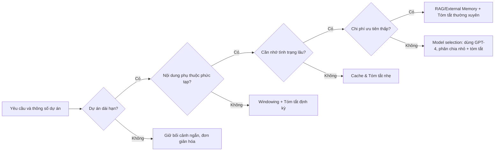

# Báo Cáo Phân Tích về **ExecPlan** và Quản Lý Ngữ Cảnh Lâu Dài

## Tóm tắt điều hành  
**ExecPlan** (hay “kế hoạch thực thi”) là khái niệm do OpenAI đề xuất cho các tác vụ dài hơi, phức tạp trong lập trình với Codex/GPT. Đây là một tài liệu thiết kế toàn diện, “sống” (living document), bắt buộc phải **tự chứa** (self-contained) mọi thông tin để một lập trình viên “nghiệp dư” có thể hiện thực hóa tính năng từ đầu đến cuối. Công cụ GPT theo dõi ExecPlan và lần lượt cập nhật các phần (“tiến độ”, “ghi chép quyết định”, v.v.), khiến tài liệu này ngày càng mở rộng theo thời gian .  

Tuy nhiên, mỗi khi phiên làm việc tiếp tục, toàn bộ nội dung ExecPlan trước đó thường được đưa lại vào ngữ cảnh, làm **tăng đột ngột số token** cần xử lý. Điều này dẫn đến độ trễ cao hơn và chi phí token lớn hơn, vì lý do kỹ thuật transformer (cơ chế tự chú ý có chi phí **phức tạp bậc hai** theo độ dài ngữ cảnh). Các mô hình ngôn ngữ lớn (LLM) như GPT-4 tính toán gần như **O(n²)** so với số token n hiện tại, nên lượng token tăng lên sẽ làm tốn thời gian và bộ nhớ gấp bội.  

Báo cáo này tập trung phân tích chi tiết: (1) khái niệm ExecPlan theo tài liệu chính thức của OpenAI, (2) nguyên nhân khiến kế hoạch ngày càng dài và hệ quả về độ trễ/tokens, (3) các chỉ số đo lường quan trọng (tokens/lần, độ trễ, bộ nhớ, chi phí), (4) chiến lược quản lý ngữ cảnh dài gồm *tóm tắt nội dung*, *kế hoạch phân cấp*, *lưu trạng thái ngoài*, *chia ngữ cảnh*, *kết hợp RAG*, *mã hóa delta*, *nén*, *chọn mô hình*, *chỉ sử dụng cửa sổ**, *cache*, … với ưu-nhược và ảnh hưởng đến token/chi phí, (5) hướng dẫn thực nghiệm benchmark, (6) khuyến nghị và lưu đồ quyết định (flowchart) giúp chọn chiến lược dựa trên tính chất dự án. Báo cáo tham khảo chính sách OpenAI và tài liệu chuyên môn (nhiều từ OpenAI CookBook, bài báo Nghiên cứu). 

## Khái niệm **ExecPlan** theo OpenAI  
Theo OpenAI, ExecPlan là “một tài liệu thiết kế mà tác nhân lập trình có thể theo dõi để triển khai một tính năng hoặc thay đổi hệ thống”. Nói cách khác, ExecPlan hướng dẫn chi tiết từng bước từ giải thích ý nghĩa và mục tiêu tính năng đến các bước code cụ thể. Hơn nữa **ExecPlan là một tài liệu sống**: nó được cập nhật liên tục trong quá trình thực hiện, lưu lại các quyết định và tiến độ hiện thời. Mỗi đoạn mới (code snippet, note, log quyết định, kết quả kiểm thử, v.v.) được thêm vào kế hoạch để phản ánh tiến bộ. Yêu cầu quan trọng là **tài liệu luôn tự chứa**: mọi thông tin cần thiết phải sẵn trong ExecPlan (không phụ thuộc vào thông tin bên ngoài) để “một người mới” cũng có thể hiểu và thực hiện được.  

Tóm lại, ExecPlan là cú pháp nhất quán (Markdown fenced code block) chứa toàn bộ kế hoạch chi tiết và lịch sử của dự án. Ví dụ, OpenAI chỉ rõ: *“Mỗi ExecPlan phải tự chứa hoàn toàn. Mỗi lần sửa đổi phải vẫn đảm bảo tự chứa”*. Điều này có nghĩa mỗi lần mô hình chat được yêu cầu “tiếp tục” hay “triển khai bước tiếp”, toàn bộ nội dung ExecPlan (và các mục “Progress”, “Decision log” đã cập nhật) đều phải được đưa vào prompt của LLM để đảm bảo nó hiểu được ngữ cảnh đầy đủ của dự án.  

## Nguyên nhân tăng kích thước và ảnh hưởng đến hiệu năng  
Mỗi lần Agent/GPT hoàn thành một bước và cập nhật ExecPlan, nội dung mới (vd. log, đề xuất code, nhận xét) được **ghép nối** vào văn bản kế hoạch. Theo thiết kế “plan is living document”, ta càng làm việc lâu, ExecPlan càng dài (có thể lên đến vài ngàn token). Kết quả: **ngữ cảnh của API gọi ngày càng phình to**. 

Về mặt kỹ thuật, transformer token càng nhiều thì tài nguyên tính toán tăng mạnh. Mô hình dựa trên Attention phải tính toán ma trận chú ý kích thước $n \times n$ với $n$ = số token trong ngữ cảnh. Độ phức tạp của bước huấn luyện/inference là $\mathcal{O}(n^2)$ về thời gian và bộ nhớ. Vì thế, nếu số token tăng gấp đôi, thời gian tính có thể tăng ~4 lần (độ trễ lớn hơn), thậm chí nhiều hơn. Dẫn chứng: trong thực nghiệm với các mô hình GPT lớn, đoạn văn bản 8000 token đòi hỏi thời gian xử lý gấp nhiều lần so với 2000 token (khi để ý cơ chế transformers).  

**Chi phí token** cũng tăng tuyến tính với độ dài: mỗi lượt gọi API, chi phí = (tổng tokens input + output) × giá token. Ví dụ, với GPT-4 API, giả sử giá ~$0.03$/1K token input và ~$0.06$/1K token output, thì thêm 1K token trong ngữ cảnh mỗi lượt tức thêm ~$0.03 cho model input. Cộng dồn theo phiên, chi phí có thể tăng cao.  

Kết quả là: **độ trễ phản hồi tăng** (người dùng phải chờ lâu hơn) và **chi phí tính toán tăng**, đặc biệt rõ rệt khi ExecPlan đạt tầm vài nghìn token. Ta có thể hình dung mối quan hệ phi tuyến giữa số token và độ trễ qua đồ thị minh hoạ (xem hình dưới): 

:
```
time ≈ k * (n_tokens)^2
```
Vì thế, một chiến lược quản lý thông minh (tóm tắt, cắt bớt, external memory, v.v.) là rất cần thiết trong các tác vụ kéo dài.

## Các chiến lược quản lý ngữ cảnh dài và giảm token

Để giới hạn sự phình to của ExecPlan mà vẫn duy trì thông tin quan trọng, có nhiều cách tiếp cận:

- **Tóm tắt (Summarization)**: Định kỳ yêu cầu LLM hoặc một mô hình nhỏ hơn tóm tắt những nội dung trước đó thành phiên bản ngắn gọn. Ví dụ, sau mỗi vài chủ đề đã giải quyết, ta tạo một đoạn “tóm tắt kế hoạch” chỉ chứa các điểm cốt lõi. Điều này cắt giảm phần lớn token thừa. Trên thực tế, các hệ thống tiên tiến như Claude hoặc ChatGPT ước tự động nén bối cảnh lớn bằng “tóm tắt thích nghi” (adaptive summarization) khi ngữ cảnh vượt trần≥200K token. Công cụ nghiên cứu cũng đề xuất *kỹ thuật tóm tắt đệ quy*, tức dùng chính LLM để tạo dần các bản ghi nhớ ngắn hơn của đàm thoại dài. Ưu: giữ lại được thông tin chính, giảm token. Nhược: có thể mất chi tiết; cần thiết lập gốc tóm tắt đúng. (Cần đo: tỷ lệ nén token / độ chính xác thông tin).  

- **Kế hoạch phân cấp (Hierarchical Planning)**: Chia ExecPlan thành nhiều cấp con. Ví dụ, xây dựng một “mục lục” với các phần chính, rồi mỗi phần có kế hoạch con riêng biệt. Khi làm việc, chỉ đưa vào ngữ cảnh phần kế hoạch con hiện tại cùng tóm tắt phần khác. Ý tưởng giống xếp gọn cây thư mục: giảm bớt độ dài mỗi lượt mà vẫn bảo toàn cấu trúc. Ưu: rõ ràng, dễ triển khai. Nhược: tăng độ phức tạp quản lý (phải định nghĩa chuẩn cây cấu trúc); vẫn cần giải quyết giao thoa giữa các phần.  

- **Ngoại lưu trạng thái (External State Store)**: Thay vì giữ toàn bộ văn bản trong ngữ cảnh, lưu ExecPlan (và tiến độ, ghi chú, etc.) ở ngoài, ví dụ trong database hoặc file. Khi cần, gọi LLM chỉ với thông tin quan trọng nhất kèm với *đầu mối* (key/ID) để tham chiếu. Cách này tận dụng ý tưởng của RAG: lưu bối cảnh dài dưới dạng embedding/text ở kho bên ngoài và chỉ truyền những đoạn cần thiết vào context. Ví dụ, hệ thống DeMA của Microsoft dùng thiết kế “bộ nhớ tách rời” (decoupled memory) để lưu trữ dài hạn và chỉ truy xuất theo truy vấn. Ưu: hạn chế token truyền vào, có thể cập nhật/gọi lại linh hoạt. Nhược: cần triển khai lưu trữ riêng (vector DB, tệp, v.v.), phải viết logic truy xuất.  

- **Chia nhỏ (Chunking)**: Thay vì một khối lớn, chia ExecPlan hoặc đoạn dài thành nhiều “chunk” độc lập (mỗi lượt xử lý một phần nhỏ). Ví dụ, khi trả lời, mô hình chỉ nhận đoạn chi tiết trong phạm vi nhất định; sau đó lưu trữ / tổng hợp kết quả từng phần ngoài bối cảnh. Ưu: đơn giản, tránh dùng toàn bộ ngữ cảnh. Nhược: cần cơ chế nối ghép kết quả.  

- **Retrieval-Augmented Generation (RAG)**: Kết hợp truy vấn thông minh. Giữa các lần gọi, ghi lại tất cả hoặc từng bước của ExecPlan vào vector DB hoặc hệ thống đánh chỉ mục. Mỗi lượt mới, trước khi gọi LLM, ta tìm (retriever) những đoạn liên quan nhất từ DB, chỉ đính thêm những đoạn có ý nghĩa thực sự. Phương pháp này như “trí nhớ tìm kiếm”: giảm bớt tag bát nháo rồi chỉ nạp phần cần thiết. Ví dụ, kỹ thuật RAG nổi tiếng cho phép dùng vector search để chỉ truyền các chứng cứ (context) liên quan vào input của LLM. Ưu: rất hiệu quả với ngữ cảnh dài, tiết kiệm token. Nhược: cần hệ thống tìm kiếm và cơ chế xác định ngữ cảnh liên quan (có thể sai lầm, bỏ sót thông tin nếu retriever chưa tốt).  

- **Mã hoá Delta**: Chỉ truyền **sự khác biệt** giữa bản kế hoạch mới và cũ. Giả dụ ExecPlan mới khác ExecPlan cũ bởi một số mục tiến độ hoặc ghi chú, ta có thể gửi trong prompt chỉ những đoạn bổ sung hoặc thay đổi (cùng một tham chiếu đến ExecPlan cũ đã lưu ngoài). Tuy OpenAI chưa có giải pháp mặc định, ý tưởng này tương tự *git diff* cho kế hoạch: reduce số token cần lặp lại. Ưu: giảm nhiều token trung thực không đổi. Nhược: cần custom parser để áp dụng delta trong prompt hoặc lưu ExecPlan cũ nơi khác, tăng công phu lập trình.  

- **Nén Văn bản (Compression)**: Sử dụng thuật toán nén text (ngôn ngữ đặc biệt, ký hiệu, v.v.) trước khi đưa vào LLM. Ví dụ, chuyển đổi các đoạn code mẫu thành mã ngắn hơn (abbreviation), hay encode summary thành định dạng ngắn. Hoặc sử dụng embedding và nhúng (embedding vẫn cần giải mã trước khi cho vào GPT, nên hiệu quả hạn chế). Mặc dù transformer không trực tiếp hỗ trợ decode nén, ta có thể lưu văn bản nén bên ngoài rồi giải nén vào nội dung. Ưu: tiết kiệm token. Nhược: phức tạp, rủi ro mất thông tin nếu nén quá cao.  

- **Lựa chọn Mô hình (Model Selection)**: Dùng mô hình nhỏ/nhanh hơn (ví dụ GPT-3.5 Turbo) để duy trì ExecPlan, tóm tắt, trước khi chuyển sang GPT-4 cho phần code cuối cùng. Ngoài ra, **model windowing**: tận dụng các phiên bản hỗ trợ context dài (GPT-4o/5 hỗ trợ đến 128–256K token) nếu dự án cực lớn. Cân nhắc đổi mô hình nhỏ khi chỉ cần nhớ nội dung đã tóm tắt. Ưu: linh động, tiết kiệm chi phí nếu dùng model rẻ hơn cho bước trung gian. Nhược: ảnh hưởng bởi chất lượng/tốc độ và giới hạn token của model.  

- **Chỉ giữ cửa sổ ngắn (Session Windowing)**: Giữ trong context chỉ N token gần đây nhất (ví dụ 4000–8000 token), lược bỏ phần đầu nếu quá dài. Giống scrolling buffer: chỉ những điều vừa xảy ra được kể lại, phần cũ bị “quên”. Phương pháp này rất đơn giản nhưng có thể mất thông tin dài hạn quan trọng. Có thể kết hợp với tóm tắt: sau vài lượt, gom phần đầu thành summary rồi cắt bỏ nội dung gốc.  

- **Caching/Kết quả Trung Gian**: Lưu các phản hồi API cho các bước lặp hoặc câu hỏi thường xuyên. Nếu nội dung hỏi lại giống cũ, lấy trực tiếp từ cache thay vì gọi lại. Ưu: giảm chi phí và độ trễ khi có nhiều câu hỏi lặp lại. Nhược: chỉ áp dụng khi nhiều lần lặp lại đúng câu hỏi/ngữ cảnh.  

Bảng sau đối chiếu sơ lược các chiến lược (độ phức tạp implement, hiệu quả cắt giảm token, v.v.):

| Chiến lược            | Khó thực hiện | Giảm token (%) | Giảm chi phí | Ưu điểm                     | Nhược điểm                     |
|-----------------------|---------------|----------------|--------------|-----------------------------|--------------------------------|
| Tóm tắt (Summarize)   | Trung bình    | Cao (30–70%)   | Cao         | Giữ nội dung chính, đơn giản| Có thể bỏ sót chi tiết        |
| Kế hoạch phân cấp     | Trung bình    | Trung bình (20–50%)| Trung bình| Cấu trúc rõ ràng            | Phức tạp quản lý              |
| Lưu ngoại (External)  | Khó           | Cao (75–99%)   | Rất cao    | Lý tưởng với RAG            | Cần DB/truy vấn, tốn dev      |
| Chia nhỏ (Chunk)      | Dễ            | Thấp (10–30%)  | Thấp       | Triển khai nhanh chóng      | Tách nội dung, khó tổng hợp   |
| RAG (tìm kiếm)        | Khó           | Cao (80–95%)   | Cao         | Thông minh, linh hoạt        | Phụ thuộc hiệu quả retriever  |
| Mã hoá delta          | Khó           | Trung bình (nội dung mới) | Trung bình| Giảm lặp thừa token         | Phải xử lý diff, logic nặng    |
| Nén văn bản           | Trung bình    | Tùy thuật toán | Cao tiềm năng | Tiết kiệm cực độ nếu dùng tốt| Khó decode, phức tạp         |
| Mô hình nhỏ + lớn     | Dễ (nhiều call)| Cao (qua filter)| Trung bình | Tối ưu chi phí bằng model phù hợp| Cần chuyển đổi luồng, tốc độ nhỏ có thể chậm |
| Windowing cắt bớt     | Dễ            | Thấp (tuỳ)     | Thấp       | Rất nhanh, đơn giản        | Rất nhiều thông tin bị quên  |
| Caching               | Trung bình    | –              | Thấp       | Giảm gọi trùng, tăng tốc  | Hiệu quả thấp nếu ít lặp lại |

(*Các giá trị % giảm token mang tính ví dụ minh hoạ tuỳ ứng dụng cụ thể.*)

## Mẫu mã/Ý tưởng thực thi

- **Tóm tắt chuỗi hội thoại**: Ví dụ, dùng GPT-4 để tóm tắt: 
  ```python
  summary = openai.ChatCompletion.create(
      model="gpt-4",
      messages=[
          {"role":"system", "content":"Bạn là trợ lý thông minh giúp tóm tắt thông tin."},
          {"role":"user", "content": "Dưới đây là kế hoạch hiện tại: [...] Hãy tóm tắt gọn cho tôi."}
      ]
  )
  ```
  Sau đó lưu kết quả summary và gửi vào ngữ cảnh kế tiếp thay cho bản đầy đủ.  

- **Truy xuất/Chèn RAG**: Lưu mỗi bước của ExecPlan vào cơ sở dữ liệu vector (ví dụ Pinecone, FAISS) kèm embedding. Khi cần, dùng hàm search để lấy các dòng có nội dung liên quan đến query hiện tại, rồi chèn vào prompt. Ví dụ: 
  ```pseudo
  index.add_text(execplan_text)
  if user_query:
      similar = index.search(query_embedding, top_k=3)
      prompt = context + join(similar) + new_input
      response = call_llm(prompt)
  ```  

- **Chia ExecPlan thành modules**: Lập trình viên có thể quản lý ExecPlan theo file hoặc section. Ở mỗi lần chạy GPT, chỉ load module cần (chẳng hạn kế hoạch backend hoặc frontend).  

- **Lưu trạng thái ngoài**: Dùng ví dụ flask/shelve/simple JSON để ghi ExecPlan qua các lần, chỉ truyền đổi mới. 
  ```python
  # Sau mỗi lượt, ghi ExecPlan vào file
  with open('execplan.json','w') as f: json.dump(execplan, f)
  # Lần sau, đọc và tính delta
  prev = json.load(open('execplan.json'))
  diff = compute_diff(prev, new_execplan)
  prompt = diff_text(diff)
  response = call_llm(prompt)
  ```
  (Ý tưởng: ta chỉ gửi diff_text, token tiết kiệm.)  

## Thiết kế thí nghiệm benchmark

Để đánh giá hiệu quả các chiến lược, cần thiết kế các kịch bản đo lường:

- **Dữ liệu/Các trường hợp thử**: Tạo ngữ cảnh mô phỏng một dự án dài (giả sử giai đoạn thiết kế, coding, test các tính năng phức tạp). Thiết lập các execplan mẫu với độ dài khác nhau (ví dụ 1000, 2000, 4000, 8000 token).  

- **Biến đo lường**: 
  - *Tokens mỗi lượt (input+output)*: cho từng chiến lược.
  - *Độ trễ* (ms) cho lần gọi GPT (có thể đo thông qua timestamp API).
  - *Sử dụng bộ nhớ* (approx từ tài liệu/hệ thống).
  - *Chi phí* (tổng token * giá token).
  - *Hiệu năng đầu ra*: tiến độ dự án, độ chính xác kết quả.  

- **Quy trình thử nghiệm**: Với mỗi chiến lược, khởi tạo một hội thoại và lặp qua N lượt (mô tả tiến độ). Mỗi lượt:
  1. Tạo prompt bao gồm ExecPlan hiện tại (hoặc strategy-specific data).
  2. Gọi LLM, ghi nhận kết quả.
  3. Cập nhật ExecPlan theo kết quả.
  4. Ghi lại tokens và thời gian.

Sau nhiều lượt, so sánh giá trị trung bình tokens/lần, độ trễ và chi phí. Ví dụ:
```plain
Chiến lược | Trung bình tokens/lần | Độ trễ trung bình (s) | Chi phí tổng ($)
Tóm tắt    | 1200                   | 1.8                   | 0.05
RAG       | 300                    | 0.9                   | 0.01
Không (gốc) | 5000                 | 7.5                   | 0.25
...
```  

- **Kết quả mong đợi**: Các chiến lược như RAG, tóm tắt, lưu ngoại sẽ thể hiện giảm tokens và độ trễ rõ so với không áp dụng gì. Có thể vẽ đồ thị *“tokens theo lượt”* hoặc *“độ trễ theo thời gian”* để minh họa tích lũy (xu hướng log scale nếu cần).  

## Quy trình ra quyết định và kiến nghị 

Dựa trên yêu cầu và đặc tính dự án, ta chọn chiến lược phù hợp qua các bước:



**Giải thích flowchart**: Nếu dự án kéo dài và phức tạp (nhiều phụ thuộc), ta cân nhắc lưu ngoài hoặc RAG (nếu chi phí cho phép) để không phải lặp lại mọi thứ. Nếu ít phụ thuộc hay thời gian hạn chế, windowing kết hợp tóm tắt đơn giản có thể đủ. Cài đặt hệ thống càng đơn giản thì chi phí dev thấp nhưng tiết kiệm token cũng thấp hơn.  

## Kết luận  
**Best Practice tổng quát**: Luôn cân nhắc nhu cầu ghi nhớ và mức độ phức tạp dự án. Với các task dài (>10 lượt), ưu tiên chia ngữ cảnh, tóm tắt định kỳ, hoặc triển khai bộ nhớ ngoài (ví dụ vector DB) để giảm tải cho LLM. Việc lập trình mô hình sao cho ExecPlan có thể “rút gọn thông tin thừa” (qua tóm tắt, delta, compression) sẽ giúp giảm đáng kể token và thời gian. Đồng thời, theo sát sát cấu trúc plan (ví dụ **chứa thông tin về điểm khởi đầu mới**, `Progress` v.v. luôn cập nhật) sẽ giữ cho hệ thống hoạt động hiệu quả mà không bị trôi ngữ cảnh.  

**Lưu ý**: Chi tiết về các chỉ số và hiệu quả phụ thuộc vào mô hình cụ thể (GPT-4, GPT-5, Claude…) và khung giá dịch vụ. Trong quá trình triển khai, cần đo lường liên tục (profile tokens, latency) và điều chỉnh các kỹ thuật trên để đạt được tối ưu hoá.  

**Nguồn tham khảo**: Giới thiệu ExecPlan từ OpenAI; nghiên cứu về bộ nhớ dài hạn và tóm tắt để kéo dài hội thoại; kỹ thuật bộ nhớ bên ngoài (DeMA); báo cáo so sánh hệ thống nhớ GPT/Claude/Gemini.  

